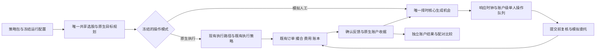

# LocalSIM 原生执行与模拟人工操作双模式 F2 详细设计

日期：2026-10-26。Feature tier：F2；风险分类：T3。状态：`IMPLEMENTATION_IN_PROGRESS`；用户已授权完成开发、审核、CI及合入，并停止在用户后端重启节点。

本设计最初通过PR #6736交付文档，随后用户授权本任务完成离线双模式、恢复与产品读取面的完整开发。当前实现工作树从`9d16f2df70f3caab4b38658c88e728c41aa88b4d`建立，并同步后续main。用户要求保留现有LocalSIM，没有要求把旧账户转换为人工模式。在线模拟的正式profile/release与持久化属于§10第五阶段；本任务不以离线功能代替在线激活。实现及实测状态见[验收报告](../analysis/localsim_human_operation_dual_mode_implementation_acceptance_20261026.md)。

上位权威：[模拟盘统一蓝图](simulation_platform_unified_authoritative_blueprint_20260715.md)。本设计使用该蓝图新增的稳定验收条目 `F-149` 至 `F-164`，不替代旧蓝图或旧研究。直接消费合同：[现有 LocalSIM 择时设计](localsim_position_timing_integration_f2_detailed_design_20261024.md)、[共享择时蓝图](position_timing_intraday_advice_localsim_blueprint_f2_20261023.md)。开发唯一规范仍为 `docs/standards/aistock_development_standard_v1.5_20260523.md`。

## 1. Background / 背景与目标

LocalSIM 的目标是自动验证策略包及配置，而不是接入真实资金自动下单。保留原生执行，可以观察策略在当前模拟执行条件下的表现；新增模拟人工操作，可以观察建议经过响应、串行操作和排队后是否仍有经济价值。整个验证由程序自动执行，不要求用户逐单点击确认。

当前 `localsim/timing.py:TimingExecution.__init__` 在打开会话时创建 OMS 父订单；四档 delay 在后续成交资格判断中生效。`timing_portfolio.py:run_portfolio_day` 按确定的 SELL-first 顺序遍历账户内多个订单，但没有跨股票共享的人工操作配额。这些是现有实现行为，不能直接命名为“已完成单人操作仿真”。新模式应在人工响应和排队结束后才提交模拟订单，而不是仅延迟成交。

现有三规则×四延迟连续研究、原288场景及其验收保留。新增操作队列、委托提交时点或期限处理形成新的实验身份，不覆盖旧结果；旧研究结果不能作为新人工模式的经济证据。

## 2. Scope / 范围

1. 保留原生 LocalSIM 的账户、执行策略、历史回放、文件/数据库来源计划、实时模拟、收益展示、恢复及幂等能力。
2. 增加显式可选的模拟人工模式，复用原生选股、目标、择时、订单、撮合、费用、账本与经济事务。
3. 提供“原生执行与人工模拟”的完整流程对照，以及人工模式内规则、响应延迟和操作能力的配对研究。
4. 首个实现阶段为文件驱动的离线自动验证；后续在线模拟消费同一操作状态机和既有 scheduler，不增加第二个常驻调度器。
5. 在现有 LocalSIM 页面展示模式、账户及比较结果；保留原账户详情和逐笔查询能力，左侧导航栏保持不变。

### 2.1 前一轮设计任务 allowed_write_scope（历史记录）

仅修改以下四个设计文件，不修改运行代码：

- `docs/architecture/localsim_human_operation_dual_mode_f2_detailed_design_20261026.md`
- `docs/architecture/simulation_platform_unified_authoritative_blueprint_20260715.md`
- `docs/architecture/localsim_legacy_retirement_and_layer_isolation_f2_detailed_design_20260830.md`
- `docs/architecture/localsim_position_timing_integration_f2_detailed_design_20261024.md`

后续实现必须在独立任务中登记精确源码、测试及 UI 写入范围；第11节的实现位置是计划，不是本轮源码写入授权。

### 2.2 2026-10-26 实现任务 allowed_write_scope

设计阶段记录保留；用户随后明确授权完整开发。实现工作树为`F:/Dev/AIstock_worktrees/localsim-human-operation-implementation-20261026`，当前允许写入以下精确文件：

- `docs/architecture/localsim_human_operation_dual_mode_f2_detailed_design_20261026.md`
- `docs/architecture/simulation_platform_unified_authoritative_blueprint_20260715.md`
- `docs/analysis/localsim_human_operation_dual_mode_implementation_acceptance_20261026.md`
- `backend/services/simulation_execution/localsim/human_operation.py`
- `backend/services/simulation_execution/localsim/human_portfolio.py`
- `backend/services/simulation_execution/localsim/native_research.py`
- `backend/services/simulation_execution/localsim/dual_mode_research.py`
- `backend/services/simulation_execution/localsim/dual_mode_projection.py`
- `backend/services/simulation_execution/localsim/timing.py`
- `backend/services/simulation_execution/localsim/timing_portfolio.py`
- `backend/services/simulation_execution/localsim/timing_store.py`
- `backend/services/simulation_execution/localsim/runtime.py`
- `backend/services/simulation_runtime/localsim_runtime_profile.py`
- `backend/services/simulation_runtime/localsim_workbench.py`
- `backend/services/simulation_runtime/localsim_workbench_models.py`
- `backend/routers/simulation_runtime.py`
- `backend/tests/simulation_execution/test_localsim_human_operation.py`
- `backend/tests/simulation_execution/test_localsim_dual_mode_comparison.py`
- `backend/tests/simulation_execution/test_localsim_native_nonregression.py`
- `backend/tests/simulation_runtime/test_localsim_dual_mode_query.py`
- `frontend/src/lib/simulation/localsim/workbench.ts`
- `frontend/src/app/simulation/localsim/components/trading-workbench.tsx`
- `frontend/src/app/simulation/localsim/components/trading-workbench.module.css`
- `frontend/src/app/simulation/localsim/components/dual-mode-comparison.tsx`
- `frontend/src/app/simulation/localsim/comparisons/[studyId]/page.tsx`
- `frontend/tests/paper-v2/localsim-dual-mode-comparison.spec.ts`
- `noxfile.py`（仅登记新UI定向验证入口）
- `tests/aistock_validation/catalog/module_registry.yaml`（仅将新UI计划登记到LocalSIM已有模块）
- `tests/aistock_validation/catalog/test_plans.yaml`（仅登记新UI定向计划，确保CI实际执行）
- `backend/services/validation/plan_catalog.py`（仅登记上述UI计划到现有命令映射，不改验证器）

实现与离线验证不操作生产账户、数据库、行情网络或服务进程；后端新进程加载与在线运行证据在用户重启后单独验证。临时计划、日志及回执均位于`X:/AIstock_temp/localsim-human-operation-implementation-20261026`。

## 3. Non-goals / 非目标与边界

- 不替换或降低现有 LocalSIM 能力，不改变旧 TWAP 默认、旧 release、已有账户和已提交经济事实。
- 不改策略包权重、因子、训练资产，不重训 QE，不恢复已退役的执行算法。
- 不复制 InferenceEngine、共享选股、`position_timing.intraday.evaluate`、撮合、费用或收益算法。
- 不经提醒 HTTP API 发模拟订单，不将提醒领取、已读或机会状态当作成交。
- 不建设人工实盘成交采集、券商接口、MiniQMT、Tick、第二套账户或监控平台。
- 本轮不查询生产数据库、不修改数据集、不抓取行情、不启动回放、不操作服务进程。
- 不以分钟代理证明真实盘口成交概率、市场冲击容量或实际人类响应分布。

## 4. Architecture / 双模式架构



`operation_mode` 与 `execution_policy` 是两个维度。原生模式不经过人工队列；人工模式只控制建议到委托的转换和操作时序，不拥有账户或成交真相。共享的是源码和只读输入；每个运行的账户、状态、业务缓存、输出及断点独立。不得复用 Advisory 的业务结果或业务容器。

### 4.1 模式与兼容矩阵

| 操作模式 | 执行策略 | 行为及兼容要求 |
|---|---|---|
| `NATIVE` | `TWAP` | 当前生产默认，原样调用现有路径；原生拆单不是人工操作次数 |
| `NATIVE` | `POSITION_TIMING_INTRADAY_V1` | 保留已批准离线研究及其原 delay、反馈和订单创建语义，不追加人工队列 |
| `HUMAN_SIM` | `POSITION_TIMING_INTRADAY_V1` | 新增 opt-in；机会先进入人工操作队列，响应和排队完成后才提交 OMS |
| `HUMAN_SIM` | `TWAP` | 首版不支持，返回明确配置错误；不得把 TWAP 子成交简单贴上人工标签 |

旧 schema 的 release 没有 `operation_mode` 时，仅按旧 schema 的只读兼容规则解释为 NATIVE；不补写字段、不重新计算旧 hash。新 schema 必须显式填写模式；未知 schema、未知枚举、缺人工政策或不支持组合均 fail closed，不能回退到 NATIVE/TWAP。旧已批准研究中的 delay 不因模式名称被归零。

### 4.2 新身份与配置归属

建议的新操作政策为 `localsim_human_operation_v1`，不把它注册成第二个择时规则或撮合算法。新离线 study schema 为 `localsim_dual_mode_study_v1`；原有 study/release schema 和结果文件不原地升级。

人工政策由 LocalSIM owner 解析、校验、展开为完整不可变 snapshot。后续运行绑定 `operation_mode`、操作政策版本/hash、执行政策版本/hash、源码 commit、run 和账户身份。生产启用时须通过现有 profile/release/control-plane authority 冻结，不能在 scheduler 内临时注入默认值；本轮不声明该生产入口已支持新字段。

## 5. Contracts / 人工操作合同

### 5.1 首轮确定性政策

| 配置项 | 首轮值 | 语义 |
|---|---|---|
| `operator_scope` | `ACCOUNT` | 一账户一名模拟操作员，多股票共享；不同比较账户不争用同一人 |
| `reaction_delay_seconds` | `0 / 60 / 180 / 300` | 每个 case 冻结一个值；60秒为主口径，其余完整报告 |
| `minimum_action_interval_seconds` | `60` | 两次实际派发的人工操作尝试至少相隔60秒，原生拒绝也消耗额度；不按自然分钟边界重置 |
| `maximum_actions_per_dispatch` | `1` | 一个时点最多派发一个人工动作，不批量瞬时提交几十笔 |
| `queue_order` | `CANCEL_THEN_SELL_THEN_BUY_READY_FIFO` | 仅在已 ready 的动作中排序；同类型按首次可见时间、股票代码、稳定动作键破同序 |
| `allow_split` | `false` | 首轮保持原冻结研究条件；部分成交不等于策略主动分批 |
| `automatic_reprice` | `false` | 不自动追价或循环撤单重挂，不补造价格区间 |
| `new_order_requires_known_account` | `true` | 下单必须有合法账户、资金、可卖量及可见反馈来源 |
| `session_policy` | 冻结交易日历/时段 | 午休和休市不处理交易动作；真实等待时长仍累计 |
| `random_response_model` | `disabled` | 首轮不制造“真实人类概率”；未来随机模型须独立版本、seed及重复试验 |

以上是可复现的研究假设，不是实测的人类能力。四档 delay 共用相同操作限速与规则。D0只是零额外反应延迟，仍受串行队列、strict-after、价格及交易资格限制，不等于 NATIVE 或即时成交。

### 5.2 输入与事件边界

操作层消费：计划及 revision、核心决策及机会边沿、当时可见的账户反馈、冻结交易时段和已完成分钟前缀。只维护 `HumanPendingAction` 与 `HumanOperationState`，不自行计算选股、目标仓位或买卖价集。

`HumanPendingAction` 至少绑定 study/account/run、plan/revision、opportunity/batch、SUBMIT或CANCEL、首次可见时间、ready时刻、有效截止、目标订单或数量、操作政策hash和稳定幂等键。只有实际合法来源支持的字段才能写入；股票目标数量不是可用资金或期初持仓的证明。

`HumanOperationState` 至少保存队列及顺序、最后动作时刻、已处理动作键、尚待确认的提交/撤单、关联原生订单、可见反馈游标和事件高水位。账户级操作员可由虚拟时钟推进，不能调用真实 sleep 等待历史时间。

### 5.3 响应、排队与时间因果

`advice_available_at` 依共享合同包含数据获取、计算和展示可见时间；历史缺真实记录时显式冻结假设。持续成立的同一机会不因每分钟轮询重置首次时间或重复入队；失效后重新出现的机会按新的边沿重新计时。

对下单动作：`ready_at = advice_available_at + reaction_delay_seconds`。派发时刻 `dispatch_at` 必须满足 ready、上一动作间隔、交易时段、计划/机会有效性及当时已可见的反馈。未 ready 的撤单不能凭类型优先级阻塞全部 ready 动作。

需要人工撤单时，`ready_at = cancellation_event_visible_at + reaction_delay_seconds`，与下单使用同一操作员和响应政策；不能赋予撤单零延迟特权。待派发机会因修订/到期被自动移除不算人工动作；已选择派发的下单/撤单尝试即消耗本次额度，即使随后因资金、价格或原生风险检查未创建订单，也不能在同一配额内连续尝试其他股票。重试沿用动作身份，明确区分一次已发生的尝试和崩溃后的重复投递。

派发前不得创建 OMS 订单或经济预留，队列中的目标只是候选意图；任何原生现金/数量预留只在正式提交后由现有链路处理。当前会话构造即创建订单的路径保留给 NATIVE；HUMAN_SIM 必须提供延迟创建接缝，不能仅把 `compute_step` 中的 delay 改大。

提交后，选起点严格晚于 `dispatch_at` 的首个合法执行 bar，继续使用冻结的 `NEXT_ELIGIBLE_BAR_OPEN / strict-after`。响应等待、排队等待与分钟网格等待分别记录，不能在派发后重复叠加同一份 reaction delay。不得先读取该执行bar的open/high/low/volume再决定是否派发；执行价格及区间容量属于后续撮合代理，不进入信号特征。

同一虚拟时刻按顺序处理：已可见的成交/取消反馈与计划修订 → 到期/有效性变化 → 因果核心评估与机会队列更新 → 最多一个人工动作。新提交订单不能使用同一时刻的执行bar。隐藏但已发生的撮合结果不能提前用于人工队列排序；原生风险检查仍使用其权威账户事实，拒绝或等待必须留痕。

时序例：两个买入机会于09:31:10同时可见，delay=60秒，操作员空闲。第一笔最早09:32:10派发，分钟代理最早使用09:33起始bar；第二笔最早09:33:10派发，最早使用09:34起始bar。若第二个机会在派发前过期，则不下单，不借用前一笔成交价；也不再在09:33:10基础上重复增加60秒反应延迟。

### 5.4 计划、委托与确认状态机

```text
OPPORTUNITY → REACTION_WAIT → QUEUED → SUBMIT_PENDING → SUBMITTED
      └→ INVALIDATED / EXPIRED                    ├→ PARTIAL → FILLED
                                                 └→ CANCEL_QUEUED → CANCELLED
```

这是操作视图，不替换现有订单状态机。SUBMIT_PENDING只是待原生接受；只有既有 OMS 的提交回读才关联正式订单。提醒数量、队列出队、动作派发均不能增加 executed_quantity。

- 未提交机会遇到修订、撤销或到期，立即移出队列并保留原因；不消耗一次实际下单额度，不产生假订单。
- 已提交委托遇到修订/撤销，不再提交旧 revision 的新意图，生成幂等撤单动作；撤单消耗同一操作预算。旧委托未确认取消前，不提交会叠加相同目标的替代委托。
- 撤单排队/在途期间若原生系统确认合法成交，计入真实模拟持仓并标记取消竞态；不能抹掉成交或重复释放资金。该成交必须仍满足原委托硬价格、期限、数量及交易规则，不是重启旧机会。
- 硬期限到达后不再撮合。现有 LocalSIM 的订单到期/安全取消与“人工撤单完成”分开记录；尚未由操作员处理的撤单形成容量欠账。分钟级自动有效期不是实际券商支持任意时刻自动撤单的证明，报告须显式披露这一假设。
- `PARTIAL`仅通过确认成交累计。撤单后重新下单的合法数量由原生规划和确认剩余量决定，重试不创建第二笔委托；首轮不启用自动追价重挂。
- 尾单/residual、终止结算不得绕过 HARD、期限、停牌、方向性涨跌停或操作配额来补齐完成率。

终止时全部未提交动作结束并保留原因；原生订单按其硬期限及原生确认合同闭合，待人工撤单欠账仅作为操作可行性证据留存，不携带成下一交易日可重新执行的旧意图。存在无法闭合的原生提交/取消状态时，当日不可提交为成功账户结果，应保留准确可恢复阻断。

### 5.5 账户、费用与收益

沿用唯一 TargetPositionEngine、RebalanceIntentService、OMS、MinuteExecutionEngine、FeeModel、ledger及economic coordinator。现金、可卖量、申报数量、T+1、停牌、方向性涨跌停、价格和流动性限制均由既有权威检查。人工操作层不创建“先当作成交、稍后对账”的平行事实。

首轮费用继续绑定已批准的只读费用文件：买0.000095、卖0.000595、最低5元、父订单累计。提醒和重试不计成新收费父单；独立新委托的父订单归属必须由原生合同确定，不能为了少收最低费而任意合并。个人券商费用另建cost policy，不改旧实验口径。

收益使用同一终点、估值、费用和公司行为口径。未成交现金、剩余持仓仍计入终值；缺必要估值为不可用，不填零收益。既有raw估值未完整处理分红送转的限制继续披露；如果缺少公司行为合同，不把结果称为真实全收益。

## 6. Contracts / 配对研究、数据与身份

### 6.1 三种比较 family

| family | 配对方式 | 可回答的问题与限制 |
|---|---|---|
| `NATIVE_VS_HUMAN_WORKFLOW` | 原生TWAP账户 vs 人工模式B0/C1/C2账户；共同外生目标来源、初态、费用和终点 | 完整操作方式对账户结果的影响；包含算法、时序、完成率和数量差异，不归因于纯择时 |
| `HUMAN_MATCHED_RULES` | 相同人工政策、delay及成交代理下，B0 vs C1/C2 | 人工操作条件下规则差异；连续持仓分化必须说明，不只统计双方成交子集 |
| `FROZEN_PLAN_RESPONSE_DIAGNOSTIC` | 同一冻结机会流/计划/初态，不同delay，操作能力保持相同 | 响应政策及队列的影响；与带反馈连续账户分开命名和汇报 |

NATIVE_VS_HUMAN保留原生TWAP成交语义，不能为凑相同代理而改写旧路径。若代理不同，报告必须列出两方合同；它不是matched B0。需要隔离规则作用时使用HUMAN_MATCHED_RULES。

### 6.2 账户人口及运行矩阵

新研究账户各1000万元纯现金，无杠杆、不追加资金；SELL持仓只来自此前合法模拟成交。现有500万元等账户不修改，也不直接与新1000万元账户作为同初态配对。

首个完整样本沿用已选定的LightGBM＋12因子包，新建一个原生TWAP对照加十二个人工账户（三规则×四delay），共13个独立连续研究账户。先用短窗口闭合接口及恢复，再完整运行相同可读区间；2026-01-05至09-30可作为已验证研究区间复用，具体calendar、输入hash和可见时间必须重新冻结，不能仅凭日期字符串认定可用。

其他可激活包先各运行一组两账户：原生TWAP与人工B0/60秒/同一限速。是否扩展十二人工组合按预先声明的研究目的确定，不能只为某包挑选历史收益最好的delay。原有12账户和288产物均不计入这13个新账户，也不被覆盖。

需要比较现有top-k、调仓频率、HMM开关、risk或费用等其他合法配置时，每份配置各建同初态的原生/人工配对组。组内除声明的操作模式及其执行政策外，其余输入保持一致；跨配置如果选股目标改变，必须报告人口和风险暴露差异，不能称为同一计划的纯执行比较。不硬编码上述示例包ID，不把配置研究变成QE重训或新增HMM/数据算法。

跨日连续研究在成交反馈后持仓和后续合法调仓数量可分化；共同的是外生选股目标来源，不强行复制另一账户持仓或成交。单计划配对诊断才要求相同计划数量和初态。

### 6.3 冻结来源与合法区间

比较request在读取收益前冻结：策略包manifest/原生模型和因子资产、日频/HMM/risk配置、PIT及股票池政策、C/D/T、输入来源计划和数据身份、价格偏好、账户初态、费用、估值/公司行为、时段/终点、操作政策、执行合同及源码commit。价格UNKNOWN/NONE按现行消费合同处理；需要价格而缺失不能补造或删掉case。

同一比较family使用同一PIT版本和共同数据截止。新研究采用本次正式指定且各来源兼容的最新政策快照；旧run保持原冻结政策，不静默迁移。来源计划创建时冻结、恢复时读取原计划；文件到数据库的边界只按正式公共合同接续，不以文件越界冒充数据库缺失，也不静默换源。离线阶段直接消费冻结文件，不查询生产数据库。

模型训练截止、选参截止和实际可用日期必须记录。使用后来形成的模型回放年初，标为回顾性研究；真正样本外区间另报。无需为了本功能重新训练。来源缺失或不兼容时保留准确阻断及影响人口，不缩期、换股或改股票池掩盖缺口。

### 6.4 事务、恢复与 exact retry

沿用既有经济事务和不可变日journal。人工队列、最后操作时刻、未确认动作、订单关联、可见反馈游标与当日原生经济事实同一commit boundary保存；不能先记队列“已下单”再独立提交经济事实。

完整已提交交易日是连续离线恢复边界。日内崩溃从前一完整提交及冻结输入确定性重算未提交日，未完成generation不得作为账户收益；进程内重试仍须动作幂等。未来在线持久化沿用既有原生minute receipt/CAS/readback，不以离线整日重算替代在线订单恢复。

exact retry读取同一结果或返回`ALREADY_MATERIALIZED`；hash、队列顺序、费用和成交不变。提交未知先读回原生事实，不能重复创建订单。操作政策、模式、输入或源码变化须新study或正式后继，禁止改变旧FAILED_TERMINAL或手改断点绕过失败。

Windows临时与结果产物放显式配置的X盘目录，WSL先验证对应挂载可读写，直接消费现有冻结文件；不使用C盘临时目录、不复制大型模型或数据。行情payload不写交易数据库，普通等待不逐分钟追加NO_FILL或无界JSON日志。

## 7. Contracts / 结果与 UI

### 7.1 新结果信封及可回读收据

新增结果schema建议为`localsim_dual_mode_results_v1`，与旧EconomicResults/连续结果并存，不修改择时研究比较器。顶层至少包含study/family、producer=LOCALSIM、source commit、每账户release/模式/政策hash、输入/初态/费用/估值/执行合同hash、共同终点、完整人口及比较资格。

每账户保留初始/期末净值、累计/分期收益、正值peak-to-trough MDD、现金/持仓、费用、目标/成交/未成交及原生receipt URI+完整文件SHA。每个原始计划在plan结果中恰好一行，`FILLED/PARTIAL/NO_FILL/UNAVAILABLE`不丢失；策略未生成交易的日也保留账户估值行。

另报首次机会、ready、dispatch、委托确认、成交/取消确认时间、响应/排队/网格/总等待、操作次数、最大队列、待撤单欠账、机会过期和取消竞态。计数区分机会、人工动作、OMS父单、子成交和收费父单，不能互相替代。

市场约束、人工响应/排队、计划失效、策略无机会、数据不可用和程序错误分别统计。停牌/涨跌停未完成不是程序失败，但其经济影响保留。未知为null/typed reason，不填零。必要输入缺失时不发布全区间成功收益，保留已提交前缀和准确受影响行。

读经济结果前先整批inspect来源、政策、账户初态及原生收据；不根据结果挑选可比较账户。条件成交价差只在双方成交子集报告，必须列配对数和缺失比例；不能用它代替整体净收益。连续反馈下无法识别的BUY/SELL净值或MDD归因保留null。

### 7.2 现有页面的增量设计

左侧导航栏不改。在现有LocalSIM总览增加“原生执行 / 模拟人工”模式标签和比较组入口；详情继续按单账户展示持仓资产、累计/当日盈亏、逐笔交易、资金及分时段统计。比较组展示两个模式的净值曲线和差异，不能把多个独立账户汇总冒充一账户。

示意：

```text
LocalSIM 总览                         [全部模式 v] [策略包 v]
策略名称：LightGBM＋12因子
  原生执行 · TWAP       资产 / 盈亏 / 回放日期 / 状态     [账户详情]
  模拟人工 · 简单执行   资产 / 盈亏 / 1分钟响应 / 排队量  [账户详情]
                                             [比较两种模式]

比较详情：同初态、同区间、同来源的资格说明
  净值曲线：原生执行 / 模拟人工
  净收益差 / 回撤差 / 成交完成率 / 费用 / 操作负担
  响应与排队 → 委托 → 成交/过期 的中文事件明细
```

正常UI不显示策略包ID、run/release编码、hash、schema或JSON日志；使用模型＋因子等已有可读名称。身份只在后台审计及导出证据中保留。程序/数据错误显示中文原因与受影响日期，不显示假成功或零收益。

账户和持仓收益继续读取服务端既有projection；新增比较结果为服务端只读projection，UI不重算账本。既有`/localsim/accounts`、账户详情、ledger、performance读取合同采用兼容新增字段，提议字段为`operation_mode_label`、`operation_profile_summary`、`comparison_ref`、`comparison_eligibility`、`human_operation_metrics`。旧账户这些展示字段可以为空，但旧经济字段和响应合同不删除。

第一阶段离线产物可以文件报告交付；不得据此宣称UI集成或在线模式已完成。UI正式接入需在现有simulation-runtime读取面登记具体版本字段与分页/权限合同，不新增执行tick、人工acknowledge门禁或提醒下单接口。

## 8. Design Acceptance Index / 稳定设计验收索引

| ID | 必须验收 |
|---|---|
| F-149 | 双模式显式opt-in，旧TWAP/default/release、离线择时研究及账户经济事实不变 |
| F-150 | 唯一共享计算、唯一账户撮合链；人工派发后才创建OMS订单，无第二账本或HTTP下单 |
| F-151 | 操作政策完整冻结、组合校验及旧schema只读兼容；未知/缺失fail closed |
| F-152 | 单账户跨股票共用操作配额、ready排序、持续机会去重、休市及D0语义明确 |
| F-153 | 可见时间、反馈时钟、dispatch及strict-after隔离；不提前读取执行bar或重复加delay |
| F-154 | 部分成交、修订/撤销、取消竞态、到期及尾单正确，确认前不重复提交替代单 |
| F-155 | 原生资金/可卖/数量/T+1/限停牌、价格与父订单费用保持，无假持仓或计费漂移 |
| F-156 | 冻结PIT/C/D/T/来源计划、价格UNKNOWN和模型合法区间，不静默切源或迁移旧run |
| F-157 | 1000万元初态、2账户基础组/13账户完整组，独立状态与共同外生目标，不改旧人口 |
| F-158 | 整流程比较、人工matched规则及冻结机会诊断分开，不把native TWAP冒充matched B0 |
| F-159 | 原生事务、队列与反馈恢复、失败前缀、提交未知读回、exact retry无重复成交收费 |
| F-160 | 全人口结果与receipt可回读，先source inspect后收益；MDD/公司行为/不可归因项准确 |
| F-161 | UI保留左侧导航、现有账户详情和独立收益，新增中文模式比较，正常页面无ID/JSON |
| F-162 | 定向/原生不漂移/短窗/连续多日/增量/恢复验证及端到端性能和复杂度证据 |
| F-163 | 分阶段启用、旧账户不迁移、无新调度器；数据/数据库/进程/生产授权状态分开 |
| F-164 | 四项设计符合性、精确写入范围、设计/功能/历史/运行/经济状态分别报告 |

## 9. Verification Plan / 验证方案与业务 oracle

| 验证组 | 输入/触发 | 必须观察的结果 |
|---|---|---|
| 原生不漂移 | 相同旧release、账户初态、分钟和时钟，代码修改前后运行 | 原生订单/成交/费用/持仓/经济hash相同；不创建人工队列；旧delay研究不被重解释 |
| 延迟提交 | 多个机会可见但尚未ready，或已ready仍排队 | OMS无提前订单/预留；实际派发后严格下一bar才可撮合 |
| 单人容量 | 多股同刻BUY/SELL及ready撤单、未来ready撤单、原生拒绝，含同序键 | 全账户任意两次动作尝试间隔≥60秒；拒绝仍消耗额度；非ready不阻塞；同输入顺序一致 |
| 因果与可见反馈 | 未来极端OHLC/成交量、反馈晚到、午休、执行边界相等 | 旧决策/派发不受未来值影响；未可见反馈不用；strict-after与休市正确 |
| 生命周期 | 持续机会、重入、修订、取消、到期、部分成交与撤单竞态 | 不重复入队/延长旧机会；旧意图不重提；真实成交不抹掉；期限后不撮合 |
| 交易与费用 | 资金竞争、无可卖量、T+1、板块数量、涨跌停/停牌、HARD、最低费 | 全部调用原生规则；程序失败与正常未完成分开；重试不重收费 |
| 崩溃恢复 | 入队后、派发前后、提交未知、成交后反馈前、日commit前后 | 原生收据读回闭合；只有完整提交前缀可见；exact retry订单/费用/结果SHA不变 |
| 比较与人口 | 短窗后完整13账户，另两账户组；NONE/UNKNOWN及无交易日 | 身份/初态/终点一致；全部行保留；异代理只作整流程对照；未知不填0 |
| UI与只读查询 | 现有账户、双模式比较、错误/不可用状态及分页 | 原账户功能和左侧导航不变；中文展示，无机器编码/JSON；查询不触发执行 |
| 增量与在线接缝 | 完整离线验收后追加新交易日；将来用户重启后的新进程 | 只推进新日，不重写旧日；在线延续同状态机与既有scheduler，不借此自动激活 |

直接测试现已落实为`backend/tests/simulation_execution/test_localsim_human_operation.py`、`test_localsim_dual_mode_comparison.py`、`test_localsim_native_nonregression.py`及`backend/tests/simulation_runtime/test_localsim_dual_mode_query.py`；既有择时、连续研究和TWAP合同继续回归。UI使用新比较页与旧工作台Playwright合同，并已登记到现有CI计划。实际运行次数及结果见实现验收报告，不将历史设计检查记作功能成功。

性能测量端到端耗时、每交易日耗时、峰值RSS、磁盘新增量、队列峰值与事件数。使用同数据区间和相同账户规模与原生对照，不预设每天40秒。队列只维护当前账户活跃动作，建议使用稳定排序/小根堆，单次入出队O(log Q)，不构造证券×分钟×账户的重复完整数据副本。性能优化不能合并不同账户经济状态或共享业务结果。

## 10. Rollout / Rollback / Risks / 发布、回滚与风险

1. **设计阶段（已通过PR #6736完成）**：冻结本合同及父蓝图条目，审查兼容/因果/交易/费用/展示，只有文档改动。
2. **离线功能阶段**：独立worktree实现操作层及延迟提交接缝，完成直接测试、旧行为等价、短窗和失败恢复。
3. **历史经济阶段**：独立新request运行13账户，再开展其他包两账户基线；先整批source inspect，保留所有结果。不得覆盖旧研究或择优改参数。
4. **产品展示阶段**：既有读取面和UI展示新产物；离线功能通过不能代替UI验收。
5. **在线模拟阶段**：另行闭合正式profile/release、持久化和新进程验证，通过既有scheduler自动运行；用户负责后端重启，现有账户不自动切换。

回滚只停止新HUMAN_SIM配置的选择并保留结果；原生执行不经过新增分支。已经成交的人工模拟账户不能通过改模式重算成原生账户；需要比较时用独立账户或正式安全边界successor，不回写历史经济事实。

主要风险：固定响应/操作能力不代表实测人类；分钟开盘代理不代表真实成交；撤单确认晚到可能形成取消竞态；硬有效期安全约束不等于券商自动限时撤单；容量不足降低完成率也可能改变风险暴露；模型训练/选参泄漏或公司行为遗漏可使收益解释不可靠。以上均需在结果中明确，不通过删计划、挑delay或归零未知解决。

## 11. Implementation Plan / 实现分工与精确接缝

| owner | 接缝与计划位置 | 边界 |
|---|---|---|
| LocalSIM execution | 新`localsim/human_operation.py`；现有`timing.py`延迟创建接缝、`timing_portfolio.py`账户级虚拟时钟；runtime/planning必要注册 | 只增加操作编排；不复制核心、OMS、FeeModel、ledger |
| LocalSIM research | 新`localsim/dual_mode_research.py`；现有campaign/store/continuation可复用接口 | 两模式request、结果、日事务、恢复与比较资格；不改旧产物schema |
| LocalSIM control/UI | 现有`simulation_runtime`的profile/release和只读projection；现有`frontend/src/app/simulation/localsim`页面 | 后续登记精确文件；不增加导航、独立账户平台、manual tick或真实下单 |
| 共享选股与择时owner | 本轮只消费现有公共接口 | 缺正式公共接口时列准确输入/反馈需求，由对应owner处理，不跨模块修改 |
| 数据/PIT authority owner | 仅在来源合同实际不兼容或必要冻结输入缺失时交接 | 不自行补数据、改PIT名称或换股票池 |

可合入标准：设计逐条有实现及直接证据，旧路径等价、恢复/幂等、完整人口/费用/因果与UI在各自交付范围闭合；定向回归、L0及当前HEAD CI通过。任何未完成阶段按其真实状态交付，不能称为完整双模式产品已完成。

## 12. Production Gates / 生产边界

实现任务`production_ddl_gate=noop`、`database_read=false`、`database_write=false`、`dataset_mutation=false`、`live_market_network=false`、`production_account_mutation=false`、`production_replay_started=false`、`user_service_process_control=false`。离线研究和测试在独立文件账户中执行；UI验证仅由Playwright启动并结束自己持有的前端测试进程。后端读取面新代码需用户重启后加载，因此`backend_restart_owner=user`、`runtime_activation=pending_user_restart`。配置`LOCALSIM_DUAL_MODE_RESEARCH_ROOT`才登记离线产物；未配置时原有工作台仍正常读取原生账户，空研究列表不代表零收益。

未来若现有release/profile无法容纳正式操作政策，必须先明确最小兼容schema方案；任何DDL/DML先在既有DEV验证，具体生产目标与迁移另按用户授权执行。设计文档不授权创建生产账户或启动生产回放。在线模式运行态激活、用户重启与正常交易日证据独立报告，不增加逐笔人工审批。

## 13. Design Acceptance Matrix / 设计验收矩阵

下列矩阵记录实现任务；完整年度研究、经济支持与在线激活分别报告，不凭功能合同测试填成已完成经济验收。旧设计阶段记录保留在§14。

| design_item | implementation_refs | test_or_evidence | status | gap_or_exception |
|---|---|---|---|---|
| F-149 | backend/services/simulation_execution/localsim/runtime.py；human_operation.py | test: backend/tests/simulation_execution/test_localsim_native_nonregression.py；旧择时/TWAP回归 | implemented | 旧配置、release及生产账户不迁移 |
| F-150 | human_portfolio.py:run_human_portfolio_day；timing.py:TimingExecution；native_research.py | test: test_two_stocks_share_one_operator_and_no_double_delay；test_native_twap_uses_existing_engine_without_calling_timing_core | implemented | 只在派发后建单，复用唯一撮合/费用/账本 |
| F-151 | human_operation.py:validate_operation_configuration；dual_mode_research.py:inspect_study | test: test_legacy_shape_and_unknown_modes_fail_closed；test_source_change_and_rehashed_population_change_fail_before_outputs | implemented | 生产profile/release入口按§10第五阶段单列，不宣称已启用 |
| F-152 | human_operation.py:HumanOperationQueue | test: test_account_capacity_rejections_cancellation_ready_and_exact_restore；持续机会与排队过期测试 | implemented | 确定性响应政策是研究假设 |
| F-153 | human_portfolio.py:evaluate_proposal；timing.py:step | test: test_future_suffix_never_changes_earlier_human_dispatch；strict-after四档延迟；反馈起点为真实提交时刻 | implemented | 执行bar完整成交量只作为披露的事后容量代理 |
| F-154 | human_portfolio.py修订/撤单/到期编排；HumanOperationQueue.invalidate_plan | test: test_partial_fill_multiple_revisions_cancel_once_then_only_confirmed_remaining；队列恢复负例 | implemented | 硬期限自动闭合与人工撤单欠账分开记录 |
| F-155 | TimingExecution.step；既有OMS/MinuteExecutionEngine/InMemoryLedger | test: 资金/可卖量、T+1、部分成交、父单最低费及原生3次子成交精确现金oracle | implemented | 不修改交易、费用或账本权威 |
| F-156 | dual_mode_research.py:_source_inspect；既有inspect_price_templates/inspect_successor_sources | test: 源码/人口变化在收益前拒绝；artifact: 冻结真实输入与完整SHA见实现验收报告 | implemented | 使用显式冻结后继，不追随可变active，不改旧run |
| F-157 | dual_mode_research.py:profiles_for及独立账户生成 | test: test_thirteen_accounts_two_days_resume_native_journals_and_exact_retry；BASIC_2文件合同 | implemented | 1000万元纯现金；完整历史状态在验收报告单列 |
| F-158 | dual_mode_research.py:summarize_accounts；execution_contract | test: 两比较family、异成交代理及quantity_matched=false；旧冻结288产物hash复核 | implemented | 原288是旧冻结机会诊断，不能当作新增人工队列或连续账户的纯延迟证据 |
| F-159 | dual_mode_research.py单writer/日恢复；原生TimingFileRepository与economic coordinator | test: 2日恢复、exact retry零重算、摘要修复及test_single_writer_and_failure_preserve_only_committed_prefix | implemented | 完整日为离线恢复边界；在线minute CAS不由整日重算替代 |
| F-160 | dual_mode_research.py全人口信封；dual_mode_projection.py只读核验 | test: 原生journal独立回放、收据篡改拒绝、分页隔离、所有状态保留；合法无目标日测试 | implemented | BUY/SELL净值与MDD归因保留null，不伪造因果归因 |
| F-161 | backend/routers/simulation_runtime.py比较GET；dual-mode-comparison.tsx | test: frontend/tests/paper-v2/localsim-dual-mode-comparison.spec.ts；旧workbench 11项回归 | implemented | 左侧导航不改，账户资产及盈亏独立；简称仅取冻结输入，不补造 |
| F-162 | 定向回归与真实文件研究；实现验收报告性能/复杂度节 | artifact: X:/AIstock_temp/localsim-human-operation-implementation-20261026；239项回归、46项时钟补验、12项浏览器验证 | in_progress | 真实短窗及连续运行测量进行中，不用功能测试替代历史经济证据 |
| F-163 | §10发布阶段；只读外部研究根配置 | test: test_unconfigured_research_does_not_touch_native_accounts；真实离线运行没有生产账户写入 | implemented | 后端重启和在线启用由用户执行，当前停在源码交付节点 |
| F-164 | §2.2精确文件范围；实现验收报告与§14 | artifact: L0/ownership/CI选择回执、四项设计符合性复核 | in_progress | 最终当前HEAD CI和合入待完成 |

## 14. DESIGN-COMPLIANCE-001 / 设计复核记录

| 项目 | 本轮设计结论 | 证据及限制 |
|---|---|---|
| no_simplified_delivery | 设计覆盖双模式、队列、因果、交易、费用、恢复、比较与UI；功能未声明完成 | §4–§13；未来实现必须逐项交付，不以文件报告代替UI |
| no_silent_error | 未知政策、缺来源、缺价格/估值、提交未知均显式处理 | §4.1、§5–§7；不默默回退或填0 |
| no_business_semantic_drift | 保留原生/旧研究语义，新人工模式及比较身份单独冻结 | §4.1、§6；原生TWAP不被冒充matched B0 |
| no_unrequested_gate_or_approval | 全程程序模拟操作，不新增逐单人工确认或审批 | §1、§7、§12；生产安全与用户重启仍按既有边界 |

| 轮次 | 审核重点 | 修正或结论 |
|---|---|---|
| R1 | 原生能力及比较解释 | 将操作模式与算法分离；原生TWAP完整保留；整流程对照与规则配对分开 |
| R2 | 因果与资金/订单时序 | 依据现有构造即创建订单的源码，要求人工派发后延迟创建；禁止双重delay及未来bar选择派发 |
| R3 | 单人容量及生命周期 | 账户级滑动动作间隔、ready排序、持续机会去重、撤单竞态与硬期限容量欠账；不把过期当成人已撤单 |
| R4 | 研究身份及交付状态 | 新13账户与旧12/288隔离；PIT/来源/训练截止/公司行为披露；仅设计、功能未实现 |
| R5 | 容量反例与日终闭合 | 补齐被拒绝的下单尝试仍消耗配额、撤单响应时间、两股时序例及日终未确认状态不可假成功，避免拒绝后无限瞬时重试 |

2026-10-26本轮设计检查：新设计F2为16/16，父蓝图为164/164，隔离设计为16/16，旧择时设计为13/13，均无warning；四个文件的L0为0 findings/0 blocking，ownership为4 mapped/0 unmapped/0 ambiguous，diff-check通过。最终链接/编号/范围及旧验收矩阵不漂移收据保存在`X:/AIstock_temp/localsim-human-operation-design-20261026/design-review-receipt.json`。这些是设计结构与范围证据；未来业务测试、历史回放和经济验收均为NOT_RUN。
