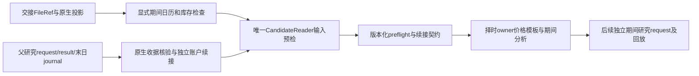

# LocalSIM 独立期间输入与账户续接契约 F2 设计

日期：2026-11-06。Feature tier：F2；风险：T3。当前交付阶段：**INPUT_AND_OPENING_CONTRACT_ONLY**。本阶段由用户明确要求先交付，后续价格模板、期间分析及真实10月回放分别验收，不以本阶段替代完整期间执行功能。

## 1. Background / 背景

10月8日至30日17个交易日已存在原包850个原生目标。父研究为1月5日至9月30日的13账户研究，已完成2353账户日。现有`dual_mode_research.freeze_study`面向同一起点1000万元空账户，不支持任意新月份起点；`timing_continuation`是同研究输入后继，不等于新研究继承旧账户。不能改写旧v1 request、重新入金、清空持仓或用原生账户状态代替其他规则账户。

上位合同：`localsim_human_operation_dual_mode_f2_detailed_design_20261026.md`的F-149/155/156/157/159/160/163/164；现行统一蓝图和`localsim_position_timing_integration_f2_detailed_design_20261024.md`继续有效。精确交接：`X:/AIstock_temp/position-timing-october-extension-20261106/LOCAL_SIM_HANDOFF.md`。唯一规范为开发标准v1.5。

## 2. Scope / 本阶段范围

交付可回读、不可变的期间准备request、正式preflight、逐日selection inventory、13份初态、累计分析锚点和字段契约。只读取已经冻结的文件；不查询数据库或服务。

allowed_write_scope：

- `backend/services/simulation_execution/localsim/period_continuation.py`
- `backend/services/simulation_execution/localsim/timing_campaign.py`（仅显式已提交文件引用的库存消费接缝，旧默认不变）
- `backend/tests/simulation_execution/test_localsim_period_continuation.py`
- `docs/architecture/localsim_period_continuation_inputs_f2_20261106.md`
- `docs/analysis/localsim_period_continuation_inputs_acceptance_20261106.md`

临时计划、回执和WSL输出位于本任务独立的`X:/AIstock_temp/localsim-october-continuation-20261106`。实现使用从最新origin/main建立的独立工作树。不会修改共享择时、Advisory、QE、HMM或数据模块。

## 3. Non-goals / 非目标

本阶段不执行10月账户回放、不做经济exact retry、不读取10月账户收益、不重新训练或推理，也不重跑1—9月。不会修改父研究、原288场景、候选、生产账户、账本、断点、数据库或服务。父研究的原生收据回读和NAV锚点读取不是策略重放。

最终可执行研究request/runner及结果schema将在择时owner交还价格模板和分析兼容后另行接入；当前准备request不可冒充可执行v1研究。经济结论保持未评价。

## 4. Architecture / 架构

继续复用`CandidateReader`、`TimingFileRepository`、`validate_day_ledger`、`InMemoryLedger`、`PositionLot`、费用模型和不可变`publish`。本模块只编排输入与状态引用，不复制评分、筛选、TopK、交易、计费、撮合或收益比较器。

## 5. Contracts / 文件与账户合同

### 5.1 请求和阶段

新准备request使用`localsim_period_continuation_preparation_v2`，绑定producer commit、LocalSIM/共享读取器源码身份、交接FileRef、候选及package、父request/results/completion、精确日期、原费用和执行政策。canonical identity与完整文件SHA分开；未来独立执行request必须再次绑定准备契约及owner价格模板。

状态`WAITING_PRICE_PLANS`仅表示本阶段通过；必要行情缺失为`BLOCKED_SOURCE_INPUTS`，列全影响日期/证券和原错误码，不能当成功或补值。身份/重复/损坏/父账户不一致直接拒绝发布。来源preflight不等待尚未交付的价格偏好模板；价格可用性不伪造。

### 5.2 精确人口和选股输入

日期由冻结候选交易日历与显式start/end交集确定，首日的C是日历前一交易日。交接中每个日期必须且只能有一对已提交projection/completion，目标包和manifest唯一、C/D/T一致，目标顺序、权重、数量、参考价、价格偏好缺失及完整来源引用保留。只消费显式引用，不扫描或混入其他包。

原生runtime release的7种绑定逐日保留。正式materialized runtime profile、manifest、政策身份和cutoff分别核对；不因release ID变化就断定换算法，也不因名称相同就忽略实际政策变化。

### 5.3 13账户初态与T+1

人口必须等于父研究的完整FULL_13，同(rule,delay,operation)一对一映射。新账户ID与新准备身份绑定，保留父账户、父study、末日day/journal/receipt的FileRef和完整hash。每户原1000万元只作为1月资金原点，不是10月再次入金。

父末日必须是新期间首日的前一合法交易日、共同14:57终点。读回正式journal代数、receipt/outbox和原生账本；现金、持仓、成本和day字段一致。无未确认的经济预留或订单债务才允许形成期间初态；不能清除未完成状态伪造安全边界。

初态同时保存父终值原状态和新账户映射状态。只通过原生`PositionLot`重绑新账户归属，通过原生`settle_trade_date`推进T+1；不按目标股数推算持仓或可卖数量。没有订单、成交或费用写入。

### 5.4 跨期估值和历史来源

每户`opening_nav_cny`固定为父9月30日14:57共同终值，`opening_marks_raw_cny`来自该末日当时可见价格。用原生账户快照核对该NAV。10月期间收益定义为新期间终值减该账户opening NAV；不减统一1000万元，不把父终值差异当作10月增量，也不把9月30日15:00收盘价混当14:57价格。

候选变化是新研究的显式文件来源变化，不是原父研究重述或同一研究输入后继。保留父/新candidate身份、匹配时点历史报价审计及数据owner已接受警告；不得因QLib文件追加导致整文件SHA不同就当作历史价格不等价。实际必要旧时点事实不一致按正式合同报告阻断，不重写现金、股数或成本。

### 5.5 行情和分析锚点

行情预检覆盖当期目标和可能保留的历史持仓，使用唯一`CandidateReader.market`读取所需分钟前缀、参考价、方向限价、日历和停牌权威；合法停牌与真缺价继续遵守共享入口，不新增算法。按已有20日/1024股预算预取并关闭资源，固定SHA和所有已消费文件pins。

父末日73只历史持仓的并集以及12只不在当期目标中的股票保留，交给owner生成SELL模板。可卖资格与选股PIT资格是不同合同，不能因不在新目标或股票池就丢弃持仓。

每户累计锚点绑定父结果中的累计费用、MDD、资本原点和原NAV day引用。为精确累计回撤，读取已冻结的父NAV观察计算其历史高水位，保留原累计MDD，不重算账户交易。期间MDD以该户opening NAV为首个峰；累计MDD承接原高水位和原MDD。此处仅交付统计所需锚点，期间分析由择时owner实现；未定义的BUY/SELL净值归因不填0。

## 6. Design Acceptance Index / 验收索引

| ID | 本阶段验收项 |
|---|---|
| PC-01 | 显式期间、合法C/D/T及精确已提交投影人口；无推理或训练 |
| PC-02 | FileRef完整SHA、manifest/政策/profile及逐日release绑定均保留 |
| PC-03 | FULL_13一对一父/子账户lineage，现金/持仓/成本和原生收据核验 |
| PC-04 | 原生T+1结算及新账户归属，保留未知与未完成债务拒绝 |
| PC-05 | 每户14:57 NAV和累计锚点，期间/累计公式和历史来源分离 |
| PC-06 | 目标及历史SELL人口的独立文件行情预检、资源预算和真实阻断 |
| PC-07 | 不可变准备request/preflight/inventory/初态，损坏或改写拒绝 |
| PC-08 | v1库存默认和旧研究、账户、数据、服务不变 |
| PC-09 | 定向负例、真实WSL输入、F2/L0/CI和owner可直接消费的字段/路径/SHA |

## 7. Implementation Plan / 实施顺序

先冻结本设计和范围；补显式库存入口；实现离线期间准备及初态；定向正负测试；WSL真实17日预检和父收据回读；多轮审核修复；更新矩阵并验证F2/L0/CI；独立PR按已有授权交付。当前交付到owner价集与分析兼容节点，后续账户回放及一次新研究exact retry不在本阶段执行。

## 8. Validation Plan / 验证

至少覆盖：日期缺失/重复、不同包/manifest/政策、父日终或账户profile错误、伪造入金/持仓和receipt、T+1与归属、NAV不一致、历史种子未出现在新目标、行情真缺价与合法停牌、文件损坏、旧默认等价、生产与旧产物无写入。测试使用既有原生账本/协调器生成的函数夹具和真实冻结文件；夹具不是历史经济证明。

## 9. Rollout / Rollback / Risks

本阶段为独立离线CLI和合同，无backend/worker/scheduler进程操作，也不要求重启作为离线前置。新文件根与父结果根隔离；失败保留证据，旧产物不覆盖。后续runner不能把v2契约伪装为v1空账户request。若发现必要输入真实缺失，交付准确BLOCKED及owner需求，不缩短17日或删股票。

## 10. Production Gates / 生产边界

`production_ddl_gate=noop`；database/service/network行情/生产账户写入均为false；不复制大型模型或候选数据。Windows临时文件用X，WSL对应目录已只读可达验证。后续在线激活不由本次离线合同或CI授权。

## 11. Design Acceptance Matrix / 验收矩阵

| design_item | implementation_refs | test_or_evidence | status | gap_or_exception |
|---|---|---|---|---|
| PC-01 |period_continuation.py；timing_campaign.py|定向日期与投影测试；真实17日库存|planned|none |
| PC-02 |period_continuation.py|SHA/身份/政策负例；真实绑定清单|planned|none |
| PC-03 |period_continuation.py|原生journal/账本回读；13账户lineage|planned|none |
| PC-04 |period_continuation.py|T+1及错误持仓/预留负例|planned|none |
| PC-05 |period_continuation.py；本设计§5.4/5.5|每户NAV/高水位及origin验证|planned|none |
| PC-06 |period_continuation.py|文件源缺失/停牌及历史SELL人口|planned|none |
| PC-07 |period_continuation.py|不可变发布与篡改拒绝|planned|none |
| PC-08 |timing_campaign.py|旧入口默认及旧文件hash保护|planned|none |
| PC-09 |test_localsim_period_continuation.py；验收报告|WSL、定向测试、F2/L0/CI|planned|none |

## 12. DESIGN-COMPLIANCE-001 / 四项复核

不简化交付：本阶段只接受用户明确要求的输入和续接合同，所有PC项逐项验收，不宣称runner或经济研究完成。不静默容错：UNKNOWN与必要缺价保留，身份和账本错误拒绝。不漂移业务语义：沿用原生交易及费用，不重置账户或改规则。不新增审批：无需等价集才提供本阶段文件，后续必要公共接口由各owner负责。
