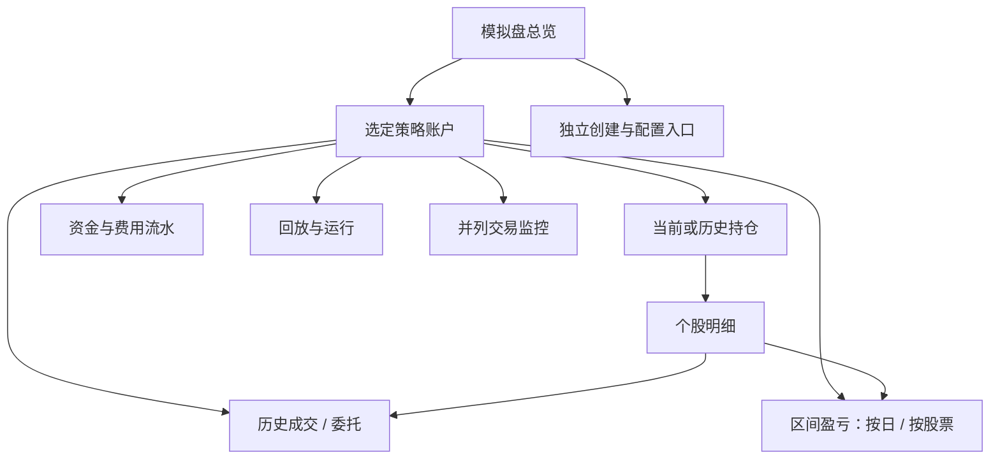

# LocalSIM 交易工作台详细设计

日期：2026-10-19；实施验收更新：2026-10-20。分级：F1，LocalSIM 单业务域只读交易工作台。状态：源码与技术验收完成，待独立 PR / CI 合入；运行加载待用户重启及后续验证。真实收益与生产回放未在本任务验收。

依据：[概要设计与页面图](../design/localsim_trading_workbench_overview_20261019.md)、[离线交互原型](../design/localsim_trading_workbench_20261019/index.html)，以及用户要求：“所有策略包 ID 等没有任何人类可读取信息的字符串、编码等不得显示”“不得修改左侧导航栏，保持原有导航栏不变”。交易软件布局仅作用于原导航右边的内容区，原型不再绘制自建侧栏或替换全局导航。

## 1. 背景、范围和明确决策

背景：当前界面主要展示配置、身份和日志，缺少从策略进入持仓、交易和区间收益的完整路径。用户已授权按现有图继续详细设计，本次重点是信息可读、账户经济事实完整，以及历史查询不误导。

本设计覆盖总览、策略账户、当前与历史持仓、个股明细、委托与成交、资金流水、区间盈亏、并列交易监控、回放运行进度。账户创建及既有控制操作沿用现有业务，只调整入口和名称展示。主路径为“策略 → 账户 → 持仓股票 → 交易 / 盈亏”。

所有用户界面使用业务名称与中文状态。内部身份继续负责账户隔离、关联、幂等、版本核验和数据追溯；不修改身份、不将名称作为经济主键。只共享既有选股计算源码，不共享荐股业务结果或收益适配器。

设计已获开发授权，本任务实现真实只读接口和右侧交易工作台。未执行数据库变更或用户服务操作；原型仍只是设计示例，生产激活与收益验收单独报告。

| 事项 | 决策 |
| --- | --- |
| 策略包 / 账户 / 运行等机器标识 | 所有用户可感知位置均不显示，包括折叠诊断和导出 |
| 股票编码 | 本轮按用户“编码不得显示”的要求，统一显示证券简称和市场；不显示数字代码或交易所后缀 |
| 模型缩写 | 不用缩写代替策略名；确需说明模型时使用可理解的中文介绍，不在交易主视图展示架构参数 |
| 身份排查 | 后端受控日志保留原身份；用户通过账户名称、发生时间、交易日和操作上下文定位，不另造短码 |
| 交易引擎 | 保留现有推理、订单、成交、持仓、资金、费用、估值和恢复合同 |
| 历史数据 | 读取已提交经济事实；不因浏览页面触发补数、重新推理、估值重算或回放 |
| vn.py 参考 | 采用监控布局和信息密度；不接入 Qt 或替换 LocalSIM 引擎 |
| 左侧导航 | 原有公共导航完全保留；本次仅重设计右侧内容区，不改变其菜单、链接、顺序、图标、宽度、样式和展开 / 折叠行为 |

## 2. 人类可读展示合同

### 2.1 展示字段与内部字段分离

读取模型分为内部关联字段与展示投影。前端表格使用显式列白名单，不遍历对象字段，不用对象序列化生成详情。服务器返回的消息或名称也不能直接视为安全展示文本。

| 对象 | 用户看到 | 仅供内部查询与关联 |
| --- | --- | --- |
| 策略 | 已验证的中文或有明确含义的策略名称、用途说明 | package / manifest / source / experiment 身份、路径、模型哈希 |
| 账户 | 可读账户名、运行用途、创建日期、初始资金 | account / portfolio / binding 身份及版本 |
| 运行 | 历史回放、实时模拟、完成日期、当前业务步骤 | run / replay / plan / checkpoint 身份、策略政策枚举 |
| 证券 | 证券简称、上海市场 / 深圳市场 / 北京市场，必要时简称有效日期 | 规范化证券身份、交易所编码 |
| 委托与成交 | 时间、股票、买卖方向、数量、价格、状态及“查看关联委托” | order / fill / event 身份、关联键 |
| 数据来源 | 数据集文件 / 行情数据库 / 实时行情，覆盖到某日、估值日期 | 数据集清单、政策、文件路径、内容摘要 |
| 错误与缺失 | 问题、影响范围、发生日期、处理建议、责任方 | 原始异常、错误码、堆栈、响应正文 |

禁止出现的位置包括正文、表格、卡片、下拉框、输入默认值、占位文本、徽标、面包屑、弹窗、空态、提示、通知、工具提示、浏览器标题、可见地址、无障碍名称、复制内容、下载文件名与文件内容。收起、缩短、截断、哈希前八位、二维码和“复制 ID”均不符合要求。正常业务数值、日期、金额、数量、收益百分比可以显示。

内部键可存在于请求参数、私有状态和不可视关联字段；这不是将其作为 UI 内容展示的授权。默认界面也不输出原始对象到浏览器控制台。不增加可展开的技术 JSON 面板。

### 2.2 名称解析、缺名与重名

策略名称优先读取原生 `display_name`，其次 `package_name`。账户读取原生 `account_name`。已核对这些字段在现有策略序列化和账户模型中存在，但不能假设字段内已有可读名称。

统一展示投影执行：去首尾空白 → 检查空值、控制字符、标识结构和已知身份字段 → 输出经过转义的可读文本。UUID、摘要、路径、实验 / 回放编号和仅机器生成的名称不能作为兜底名称；名称里夹带这些内容也整项拒绝，不只检查整串相等。使用可测试的确定性规则和业务字段白名单，不调用语言模型猜名字，不维护策略包 ID 白名单。优先中文描述，含义无法确认的机器名称使用缺名提示；保留“沪深300增强”等正常业务名称中的数字。前端最后一道字段级检查与后端保持同一合同，服务异常时也不回退显示原值。

缺策略名显示“策略名称待完善”，附已有可解释用途；缺账户名显示“历史模拟账户”或“日常模拟账户”。这些是展示投影，不改原生记录，不编造模型能力或策略收益。原型使用“多因子精选”“趋势轮动”“稳健均衡组合”等演示名，不能把这些示例名绑定到生产包。

重名先使用用途、创建时间和初始资金等可读上下文区分；仍冲突时显示“同名账户一 / 二”，按完整账户列表的创建时间和内部主键稳定排序生成，仅用于展示。分页、搜索或排序不改变编号；新增更早记录需触发整组重算且原选择仍按内部键保持。不同包同名、同包多账户均保留独立行，不合并资产。不能用 ID 后四位解决重名。

证券名称从现有公共证券元数据读取，批量解析，禁止逐持仓访问外部行情。优先使用估值日有效名称；仅有当前简称时标注“当前证券简称”，不能伪称历史简称。查不到时显示“证券名称暂不可用 · 上海市场”等，仍按内部证券身份查询和下钻；不以错误名称代替证券，不回退显示代码。重名证券使用市场和可用的正式名称上下文区分。名称未知不得影响成交量、费用和盈亏合计。

### 2.3 状态、错误和文本映射

业务状态采用封闭映射，支持等待开始、历史回放、正在选股、正在处理交易、交易已完成、估值待完成、回放受阻、既定区间已完成、等待安全接续、实时模拟、暂停、已停用。内部枚举仍按现有模型保存；未认识的枚举显示“状态暂无法识别”，标记待核验，不能默认为成功。

错误投影为“发生了什么 / 哪个日期和证券 / 对资金与进度的影响 / 下一步和责任方”。例如“七月十日所需分钟行情尚未通过当前输入核验；回放暂停，资产停留在七月九日；请核验行情覆盖及原任务恢复条件”。证券名不可得时省略名称并说明无法解析。

API 错误先转换成已登记的类型及安全业务参数，再生成中文提示；禁止展示 `Error.message`、原始 `detail`、堆栈和任意上下文值。未知错误显示“本次读取失败，保留上次结果；请按当前账户和发生时间核查”，真实原因仍记后端。缺失和过期不得被隐藏成零值、无持仓或成功。

## 3. 页面结构与导航

**左侧原导航保持不变。**现有 `frontend/src/app/layout.tsx` 继续挂载 `Sidebar`，`frontend/src/app/Sidebar.tsx`、`frontend/src/lib/navigation/nav-groups.ts` 及 `frontend/src/app/globals.css` 的导航和公共壳规则均不在本次修改范围。不得通过页面样式、媒体查询、隐藏、覆盖、重新挂载或新增窄侧栏间接改变它；不为模拟盘增加第二套全局导航。导航现有状态管理和告警行为保持原样。

以下页面图、标签和下钻均位于现有 `.app-main` 内。账户选择、返回总览、交易查询和盈亏切换通过内容区标题、面包屑和标签完成。现有导航的模拟盘入口及链接保持原样，由对应页面承接工作台或兼容跳转，不要求修改导航数据。离线原型及五张图只展示右侧内容，不代表完整应用外壳；没有绘制左栏不意味着运行时隐藏左栏。

应用入口固定为 `/simulation/localsim/workbench`，用户界面称“模拟盘”。账户及股票的内部选择写入页面状态和当前浏览器会话，地址不拼接内部 ID。标签和日期等有意义筛选可保留在查询参数；浏览器前进 / 后退通过历史状态恢复同一账户及筛选，刷新先从会话恢复身份，再与有权读取的最新账户集合核对。失效选择提示后返回列表，不自动切换至另一个账户展示资金。

旧账户编号路由保留兼容入口但在完成校验后替换为固定工作台地址；迁移涉及的旧账本、绩效和诊断页面不得继续作为可见的漏出入口。跨浏览器打开固定地址先选账户，不为此增加公共短 ID、数据库映射或不可靠名称主键。会话状态按用户隔离，登出清除。

原型使用可读中文片段表达页面位置，仅用于离线评审；正式应用使用上述固定地址与私有选择状态。查询 API 内部仍使用既有身份。视图切换是只读操作；点击、双击、回车均不能隐式撤单、恢复回放或切流。

同一展示合同覆盖 LocalSIM 的创建、配置、回放列表及回放详情，而非只美化新工作台。选策略时展示可读名称、用途与创建日期；选择账户、执行政策、行情来源、配置版本时展示业务名称与规则摘要，例如“目标持仓五十只”“数据集覆盖至八月三十一日”。内部策略政策身份仍按原合同绑定，不在 UI 改名或迁移。旧入口的身份表、复制编号和原始配置 JSON 都应由对应业务字段替代；需要保留但尚未完成的配置操作不能以按钮消失冒充改版完成。

## 4. 总览与账户详情

### 4.1 总览

按既定页面图顺序展示标题及刷新、待处理摘要、实时汇总四卡、收益走势及资产分布、策略账户表、简短系统状态。创建配置收进独立入口。默认筛选为全部账户，支持策略 / 账户名搜索、运行阶段筛选和资产截止日排序；点击行或详情按钮均进入明确账户。

| 区块 | 字段与行为 |
| --- | --- |
| 待处理摘要 | 受影响账户数、可读账户名、发生日、影响与入口；无原始日志 |
| 实时四卡 | 可比实时账户总资产、今日净盈亏、可比累计收益、运行 / 受阻数量；标注纳入范围 |
| 曲线 | 仅使用同口径真实序列；无合法基准时不显示示例基准或超额收益 |
| 策略行 | 策略名 / 账户名、用途、阶段、估值时点、资产、累计净盈亏及方法、持仓数 / 仓位、完成日和下一事项 |
| 系统状态 | 后端核验时间、页面读取时间分别展示；全局前置检查通过的含义与每账户接续状态分开 |

历史回放账户在各自行上展示经济时钟，不加入今日实时合计。多个实时账户也必须对齐估值边界和收益方法才可汇总；不齐时显示可比子集和排除原因。累计组合收益不得对账户百分比求算术平均；没有统一口径时只列账户收益。真实零持仓应有完整快照证明，读取失败不显示“零只”。

### 4.2 策略账户详情

固定顶部显示策略名、账户名、运行用途、阶段、初始资金、币种、经济截止时间、最近读取时间与切换账户。六卡为总资产、累计净盈亏、今日 / 最近估值日净盈亏、持仓浮盈、市值、可用现金；冻结资金单列说明。卡片没有足够数据时显示缺失原因。

中部沿用收益曲线与持仓费用摘要，下部标签为持仓、成交、委托、区间盈亏、资金流水、回放运行、交易监控。所有标签共享同一账户上下文。切换账户取消旧请求，响应身份与当前选择不符时丢弃，不能短暂呈现上一账户内容。

### 4.3 持仓表与个股明细

默认查询最近完成的权威持仓日，允许选择已完成历史日。持仓表须返回完整集合后显示持仓总数和合计，不能以固定 LIMIT 的多日行集拼接。

| 列 | 展示规则 |
| --- | --- |
| 股票 | 证券简称、市场、简称有效说明；固定首列，可点击 |
| 持仓 / 可卖 / 冻结 | 三项独立含义；未知不可卖数量显示待核验，不能以持仓量填充 |
| 账本成本 / 估值价 | 标注成本是否含费用；估值来源、价格时点和参考价原因可按需查看中文说明 |
| 市值 / 浮盈 / 浮盈比例 | 来自同一估值集合；缺价时保留数量和成本，市值与派生盈亏显示不可计算 |
| 最近估值日贡献 | 账户日期与该股票贡献口径一致；不能用浮盈差冒充当日净收益 |
| 账户占比 | 分母为同一时点资产；分母或市值未知时不算比例 |

个股抽屉展示上述信息、增减仓摘要、相关成交及费用。提供“完整交易记录”和“区间盈亏”下钻，携带内部账户、证券及已选区间；关闭抽屉恢复焦点和滚动位置。已清仓证券也可从历史成交和盈亏表打开明细，显示所选日零持仓及历史贡献，不硬套当前持仓数组。

历史日不存在合法持仓集时显示缺失，不自动选用邻日或最新仓位。停牌参考价沿用既有合法估值证据，业务说明为“停牌参考价，报价截至某日”；普通可交易证券缺价继续显式报错，不由查询端补值。

## 5. 成交、委托、资金与监控

成交和委托使用不同表、不同数量合计。筛选为日期区间、证券名称、买卖、委托状态；支持稳定游标翻页、显示已载入数量及完整覆盖状态、筛选清除、完整导出。排序变更重置游标。日期范围按北京时间交易日解释。

| 页面 | 字段 | 下钻 |
| --- | --- | --- |
| 成交 | 时间、股票、方向、成交价、数量、金额、佣金 / 税费 / 合计费用 | 关联委托、该股明细、对应资金流水 |
| 委托 | 时间、股票、方向、委托价和数量、累计成交、剩余量、状态、业务原因 | 全部部分成交、按时间排序的状态变化 |
| 资金 | 时间、资金类型、业务说明、带方向金额、已知余额、业务关联 | 对应成交及分项费用；无证券的资金流保留 |

关联展示为“查看本次买入”“查看关联委托”“查看两笔部分成交”，不用编号列或人为生成短码。两笔同时间、同证券、同金额记录仍按真实身份保留，不能按可见字段去重。冻结与解冻是资金状态变化，不当作外部入金和出金。

最低五元佣金通过实际账本体现；费用含订单级最低佣金时，成交级分摊须沿用原引擎结果并说明，不能逐笔再次套五元。查询可汇总交易费用 / 成交额、小额成交数量，但不推断费用可忽略。手续费规则与引擎结果不一致时如实显示待核对。

并列交易监控使用相同摘要、持仓、最近成交、委托和业务事件组件，只改变布局与最近记录窗口。每个分区标注经济或事件时点；“最近记录”不能充当完整历史。紧凑布局不增加另一套轮询缓存，不新增手工下单 / 撤单。切换分析布局保持账户和筛选。

## 6. 区间盈亏合同

### 6.1 边界和公式

区间输入为起止日期，快捷项为今天、近一周、近一月、年初至今、自定义。服务端解析合法交易日边界并同时返回用户区间与实际边界。开始日的期初使用前一合法收盘；账户首日只能用已有正式期初资金或期初账本，不能推算一个虚拟快照。结束日使用选定范围内合法期末；当前盘中只能作为明确标记的盘中估算，不混入已完成收盘序列。

`区间净盈亏 = 期末权威净资产 − 期初权威净资产 − 区间净外部资金流入`。

权威净资产和资产构成以现有引擎 / 账本定义为准。当前持久化路径使用现金加持仓市值；冻结现金不能重复相加，未来若已有应收应付或公司行动科目则按原定义纳入并解释。查询层不另建成本核算或收益引擎。

盈亏桥接为“已实现 + 未实现变动 + 分红及其他收益 − 尚未计入成本的费用”。成本、已实现和费用已有包含关系时只计一次。读取模型明确返回成本含费、已实现含费与分项费用归属；任一口径不能确认时，保留可证明的净资产差额，相关分解显示不可计算并列出缺口，不能为凑平等式倒挤‘其他收益’。

无外部流入流出且边界完整时可采用净盈亏 / 期初净资产。存在资金流时只使用现有权威、可验证的方法；若尚无方法，保留金额并显示收益率暂不可计算，不在本次另造时间加权或资金加权算法。累计收益与区间收益注明方法，不混用。

### 6.2 按日与按股票

| 维度 | 字段 | 完整性要求 |
| --- | --- | --- |
| 按日 | 日期、期初 / 期末资产、外部净流入、净盈亏、已实现、未实现变动、费用、覆盖 | 合法交易日逐日记录；未交易但已估值日仍保留；缺失日可见 |
| 按股票 | 股票、期初 / 期末数量、市值与成本、买入 / 卖出量和金额、已实现、未实现变动、分红、费用、净贡献 | 期初持仓、区间交易和期末持仓的并集，包含清仓股票 |
| 非股票项 | 已登记的账户费用、利息或其他已知科目及金额 | 有原账本依据；不得作为未解释差额的桶 |

按股票贡献从既有持仓成本、成交与现金科目做只读勾稽；缺少权威逐股归属时显示该列缺失，不另用 FIFO 或平均成本算法回算。只有分项证据齐备才显示“已对账”。净贡献合计加已证明非股票项必须对齐账户净盈亏；小数舍入差额仅允许在规定精度内独立说明，超界标记不一致。

图表按实际权威点绘制，缺失点断线并说明，禁止插值伪造收益。点击某日进入同账户当日成交 / 持仓，点击股票进入保持区间的个股明细。区间覆盖不足时允许展示已知部分与覆盖范围，但不将其标作完整区间结果。

## 7. 只读服务及接口设计

### 7.1 已核实基础和所需变化

当前 `LocalSimEconomicQueryService.ledger()` 按数量截取订单、成交、资金、持仓与快照；成交读取与最近运行有关，持仓可能包含多日。`performance()` 读取限量日快照；`list_runs()` 联合生命周期与经济运行投影，同一运行的不同投影并非两次经济事件。这些接口可用于旧页诊断，不能直接作为完整交易工作台的财务事实集合。

已有原生策略序列化暴露 `display_name` / `package_name`，账户模型有 `account_name`。估值路径已保留价格来源、时点和合法停牌参考证据，估值待完成与执行结果也有独立状态。新查询应读取这些事实，避免把交易完成误认作收盘估值完成。

在现有 LocalSIM 经济查询服务周边增加展示投影和只读路由，不修改 Advisory、QE、StrategyPackage、HMM、数据生产或撮合模块。证券名称通过已有公共元数据合同消费；如缺少公开入口，给 owner 最小批量读接口需求，不引入私有 QE 服务依赖。

### 7.2 类型和响应信封

以下字段为内部技术合同，可用于开发文档和 API，不得照搬到产品 UI。

| 部分 | 合同 |
| --- | --- |
| 关联 | account / portfolio / security 等内部身份由服务端解析校验；名称不能替代主键 |
| 金额 / 价格 | 十进制定点字符串或 null；数量为整数；禁止非有限值。沿用原存储精度，不通过浏览器浮点累计财务结果 |
| 结果状态 | complete / partial / unavailable，及字段级缺失原因；0 只代表已证明的零 |
| 时钟 | economic_as_of、valuation_kind、observed_until、backend_checked_at、fetched_at 分开；时间戳含时区 |
| 一致性 | snapshot_set / generation 与区间边界；各组件拼合前检查匹配，冲突则重读并标记，不拼接 |
| 覆盖 | 请求区间、实际边界、应有 / 已有日期、未知证券数量、是否完整、可用范围；不在 UI 显示内部身份 |
| 分页 | items、next_cursor、has_more、loaded_count；total_count 可未知，未知时不能用 loaded_count 代替总数 |
| 业务文案 | 经验证的名称、状态映射和类型化错误；原始 exception / context 不属于展示字段 |

查询采用同一短时一致性读取中的权威已提交版本；跨请求依赖已持久化的快照集合及经济提交版本。不能只用页面时间戳伪装一致。若现有版本无法形成稳定集合，返回明确能力缺口，保持最后完成集合，不新建持久化副本掩盖问题。

### 7.3 拟新增端点

相对现有 LocalSIM API 路径列出下表，实施时复用既有认证、账户访问校验、错误响应及限流。所有 GET 无业务写入。

| 相对路径 | 输入 | 输出与限制 |
| --- | --- | --- |
| `GET /localsim/workbench/overview` | 阶段、名称搜索、排序、列表游标 | 可读账户行、分组关系、同口径汇总、独立运行和经济时钟 |
| `GET /localsim/accounts/{account_id}/summary` | 可选估值边界 | 一致摘要、费用口径、运行阶段、可用历史范围 |
| `GET /localsim/accounts/{account_id}/positions` | as_of、名称筛选、排序 | 同日完整持仓集合及覆盖；大集合分页必须保留同一集合，总计服务端计算 |
| `GET /localsim/accounts/{account_id}/trades` | start、end、security、side、cursor、page_size | 完整历史筛选；不依赖最近若干运行的截断集合 |
| `GET /localsim/accounts/{account_id}/orders` | 同上，加状态 | 委托与部分成交关联；查询详情仍核验账户归属 |
| `GET /localsim/accounts/{account_id}/cash-flows` | start、end、type、security、cursor | 全量账本分类、费用与外部资金区分、业务关联 |
| `GET /localsim/accounts/{account_id}/pnl` | start、end、group_by、security、cursor | 区间摘要及按日 / 证券行、净资产桥接、缺失与对账状态 |
| `GET /localsim/accounts/{account_id}/events` | 时间范围、业务类别、cursor | 中文结构化进度，不返回任意日志对象供直接渲染 |
| `GET /localsim/accounts/{account_id}/export` | 数据种类、同样筛选、格式、一致性版本 | 完整筛选导出及覆盖说明；不得跨账户或退化为当前页 |

历史日期范围为闭合交易日区间，事件时刻过滤采用对应北京时间边界；数据库时间戳由服务层规范化。游标签名绑定账户、筛选、排序及版本，不允许改筛选沿用旧游标。排序使用稳定的“交易日、发生时间、内部身份”组合；正反向翻页不得漏行或重行。新成交出现在顶部时，既有历史分页保持起始版本，提示用户刷新，不让记录在页间漂移。

默认分页 50 条，单页上限 200 条；持仓通常一次获取，但仍遵守集合完整性。服务端支持超时、取消、资源释放。导出使用同一版本的受控流式读取；到达资源限制必须明确失败或要求缩小范围，不能输出被截断却标为完整的文件。资源阈值依据现有服务配置和验证结果设定，不在设计中承诺任意规模一次成功。

### 7.4 数据权限与行情边界

账户身份从 LocalSIM 原生账户和绑定解析，不能只信任浏览器提供的 portfolio 或 package。历史成交查询覆盖原账户所有合法运行，生命周期和经济投影关联而不重复求和。只读缓存按用户权限、内部账户、经济集合、日期、筛选和展示合同版本隔离；禁止按策略名或包名共享结果。

账本本身持久化于数据库，查询账本不等于回放行情访问数据库。历史行情的文件 / 数据库选择、数据集终点、PIT 政策和冻结输入沿用原合同；本功能不增加越界自动回退、不改冻结策略、不消费 Advisory 私有收益结算。缺少权威估值时只显示缺失，不隐式访问最新行情填补历史。

## 8. 前端组件、刷新与交互细节

组件分为工作台壳、账户选择、摘要卡、资产曲线、持仓表、成交表、委托表、资金表、区间分析、个股抽屉、业务事件列表和统一数据状态。分析页与监控布局复用相同组件和查询键；名称、金额、状态、来源、错误统一使用受控展示器，不允许组件自行拼接原始字段。

前端保留现有 React / Next.js 与 shadcn 兼容组件。汇总和财务计算在服务端完成，浏览器负责格式化和展示。禁止 `JSON.stringify(payload)`、对象通用属性表、任意错误直接 toast、ID 路由链接及原样下载接口结果。

| 视口 | 布局 |
| --- | --- |
| 内容区可用宽度 1600 / 1440 | 摘要六卡、双栏图表、紧凑持仓表；监控四分区；左侧原导航保持不变 |
| 内容区可用宽度 1024 左右 | 卡片三列、图表可纵排；保留账户与时点，表格独立横向滚动；不改外层导航 |
| 内容区可用宽度 390 | 卡片两列、图表纵排、监控单列；股票首列固定，内容区不横向溢出；原导航行为由既有外壳决定 |

响应式断点针对右侧实际可用空间，不以改变左栏宽度或移动端自动收纳左栏来换取布局空间。新样式限定于 LocalSIM 内容组件，不能修改全局 `.sidebar`、`.app-shell` 或 `.app-main` 规则。完整应用在窄设备上的既有外壳行为不属于本次改版范围。

数值右对齐、千位分隔、金额保留原精度后显示、红盈绿亏并带正负号；状态同时有中文，不能只凭颜色识别。委托买卖方向与盈亏颜色含义分别标注。键盘可进入账户和股票，抽屉有焦点约束和返回，支持 Escape；表头说明不可仅悬停获取。

运行摘要前台默认 5 秒、账户资产前台默认 10 秒刷新；历史列表在筛选或主动刷新时读取，不重复拉取全历史。按当前可见资源刷新，标签切后台后停止普通轮询，恢复时重新验证。以上为待负载验证的起始配置，不是实时行情频率或性能承诺。单次轮询完成前不重叠启动，同资源合并请求，切账户取消过期请求；不新增全局“全部账户 × 全部标签”轮询。

状态包含首次加载、完整数据、空结果、部分数据、保留上次值且过期、读取失败、名称缺失、估值缺失和无权限。零记录只有在查询完整且确实无记录时显示。过期提示必须同时说明最后经济时点与读取失败时间，刷新按钮不能触发恢复、补算或切流。

## 9. 导出与运行状态

导出使用中文文件名、中文列名、可读策略 / 账户 / 证券名、所选及实际统计区间、币种、估值口径和覆盖说明。没有 ID、代码、哈希、内部路径、机器枚举列、隐藏 sheet 或单元格备注中的内部身份。关联记录使用业务描述；无法在纯文件中完整保留关系时说明可回页面下钻，不以短码补足。

CSV 为 UTF-8（兼容常用表格软件），金额作为精确文本写出；处理引号、换行及公式注入。筛选结果按稳定版本完整读取，导出页数、数量与查询口径核对。生成失败明确报错，不发布半个文件。浏览器生成的下载名也不得含账户或运行编号。

回放进度分开显示：计划区间、已完成交易日、当前处理日 / 步骤、最后合法估值日、下一处理事项、实时接续状态。全局切流条件仅作为系统安全摘要，不能代替账户接续能力。历史区间完成和追平当前交易日不同，交易执行完成和估值完成不同。

停牌、涨跌停及无可用成交量属于市场约束，展示未完成数量和原因；是否交易日失败由既有正式合同决定，不能在 UI 中把未全量调仓统一标红失败。程序异常、输入缺失和不支持的恢复分别说明责任；按钮权限、前置条件和恢复流程使用现有服务，不新增手改状态入口。

## 10. 实施方案、文件与责任边界

下列为原设计的责任位置；实施采用相邻专属只读服务和专属前端展示模块，实际文件清单见实施验收记录，未改动既有经济写入服务。

| 位置 | 改动 | owner |
| --- | --- | --- |
| `backend/services/simulation_runtime/localsim_economic_query.py` 及邻近新增展示模型 / 查询文件 | 明确集合、分页、费用口径、盈亏只读勾稽和可读投影 | LocalSIM |
| `backend/routers/simulation_runtime.py` | 新增只读路由与类型响应；保留现有控制面 | LocalSIM |
| `frontend/src/lib/simulation/localsim/types.ts`、`api.ts` 及对应查询 hooks | 展示类型、隔离查询、取消与一致性检查 | LocalSIM |
| `frontend/src/app/simulation/localsim/` 中现有总览、账户、账本、绩效、回放页面及组件；新增 `workbench/page.tsx` | 工作台、各明细、状态、配置入口、旧入口过渡和名称规则 | LocalSIM |
| LocalSIM 对应后端 / 前端测试目录 | 财务查询、历史分页、未知、身份隔离、无代码漏出、主要交互 | LocalSIM |
| 公共证券元数据入口 | 仅在缺少批量简称 / 市场查询时确认接口；输入内部证券及日期，返回名称和有效性，不修改数据 | 数据 authority owner |

不需要荐股统一实现本工作台；共享选股内核不承担本账户账本查询与展示。证券历史简称缺口交给数据 owner 明确合同；现有成本或逐股归属证据缺口先在 LocalSIM 核对权威账本。若必须改变交易经济语义，停止相应实现并补充设计，不能以 UI 需求擅自引入第二套财务算法。

实施顺序为：① 只读类型、名称和时点合同；② 持仓 / 历史交易 / 资金完整查询；③ 区间勾稽及未知覆盖；④ 总览与详情、旧路由迁移；⑤ 个股下钻、导出、并列监控；⑥ 多轮审核修复与定向回归。每步均保持原账户状态和账本不变，不自行启动生产回放。后端运行态加载仍由用户重启后核验。

性能验收记录真实数据量、估值范围、页大小、冷热缓存、请求次数、端到端耗时和峰值内存；总览采用批量读取避免每行重复查询。先测现有查询基线，再比较新接口；不预设秒数，不以演示页面加载速度代表经济查询性能。

## 11. Design Acceptance Index、验证方案与设计验收矩阵

沿用概设 LSUI 稳定编号；为兼容现有 F1 校验器，下表增加一一对应的 F 系列验收别名，原 LSUI 语义不变。下表 PASS 指源码、接口、交互与只读技术验收；不代表用户运行中的后端已加载，也不将真实账本的未知收益判定为已结算。具体命令、提交、回执及真实勾稽见 §13 和实施验收记录。

| design_item | implementation_refs | test_or_evidence | status | gap_or_exception |
| --- | --- | --- | --- | --- |
| F-001 | LSUI-01 账户总览；localsim_workbench.py::overview / _aggregate_overview；trading-workbench.tsx::TradingWorkbench | backend/tests/simulation_runtime/test_localsim_workbench.py::test_realtime_aggregate_excludes_historical_and_misaligned_economic_clocks；validation-receipt: 12e125c9 | PASS | none |
| F-002 | LSUI-02 持仓与资金；localsim_workbench.py::_positions / view；持仓及六张资产卡 | backend/tests/simulation_runtime/test_localsim_workbench.py::test_historical_holdings_are_run_scoped_and_empty_latest_is_real_zero；artifact: real-optimized-r4.json（三账户真实勾稽） | PASS | none |
| F-003 | LSUI-03 个股下钻；trading-workbench.tsx::stockFilters / fullStock / 个股抽屉 | frontend/tests/paper-v2/localsim-trading-workbench.spec.ts；validation-receipt: 12e125c9（历史日、已清仓、焦点与筛选继承） | PASS | none |
| F-004 | LSUI-04 成交与委托；localsim_workbench.py::view；trading-workbench.tsx::OrderDialog | backend/tests/simulation_runtime/test_localsim_workbench.py::test_order_association_contains_all_partial_fills_without_cross_order_rows；frontend/tests/paper-v2/localsim-trading-workbench.spec.ts（121 条全部部分成交） | PASS | none |
| F-005 | LSUI-05 区间与逐股盈亏；localsim_workbench.py::_pnl；区间分析与逐日下钻 | backend/tests/simulation_runtime/test_localsim_workbench.py::test_closed_stock_and_actual_five_yuan_fees_reconcile_without_repricing；财务专属 37 passed；artifact: real-oracle-r3.json | PASS | none |
| F-006 | LSUI-06 资金与费用；localsim_workbench.py::view / _pnl；资金和费用表 | backend/tests/simulation_runtime/test_localsim_workbench.py（实际 5 元两笔，仅扣一次；缺分项与未知外部流保持未知） | PASS | none |
| F-007 | LSUI-07 全界面无原始 JSON；显式列白名单；配置、回放、状态及旧页迁移 | frontend/tests/paper-v2/localsim-trading-workbench.spec.ts（全部七标签、弹窗、失败与导出） | PASS | none |
| F-008 | LSUI-08 回放 / 实时及时间；localsim_workbench.py::_summary / _is_close；独立运行与读取时钟 | backend/tests/simulation_runtime/test_localsim_workbench.py::test_intraday_snapshot_cannot_become_close_to_close_return；artifact: real-oracle-r3.json | PASS | none |
| F-009 | LSUI-09 并列监控；trading-workbench.tsx::section / monitor，同账户同版本四区 | frontend/tests/paper-v2/localsim-trading-workbench.spec.ts；validation-receipt: 12e125c9（所有标签 / 监控） | PASS | none |
| F-010 | LSUI-10 未知、过期与市场约束；presentation.ts；readback-status.tsx；localsim_workbench.py::_mark_description | frontend/tests/paper-v2/localsim-unified-control-plane.spec.ts；backend/tests/simulation_runtime/test_localsim_workbench.py（真缺价保留、完整性损坏、暂停估值） | PASS | none |
| F-011 | LSUI-11 交易和共享边界；仅只读 GET / 展示服务；既有控制 API 沿用 | validation-receipt: 24926900（模拟核心及附加定向回归）；artifact: real-optimized-r4.json；源文件范围审查 | PASS | none |
| F-012 | LSUI-12 全面禁止机器标识；localsim_workbench_presentation.py；workbench.ts::human；固定可见路由 | frontend/tests/paper-v2/localsim-trading-workbench.spec.ts::noOpaque；backend/tests/simulation_runtime/test_localsim_workbench.py::test_names_never_fall_back_to_machine_strings | PASS | none |
| F-013 | LSUI-13 缺名与重名；localsim_workbench.py::overview；中文受控兜底 / 创建时间 / 稳定重名顺序 | backend/tests/simulation_runtime/test_localsim_workbench.py（恶意名称、数字业务名、同账户独立事实）；artifact: real-readonly-r2.json（三账户缺名投影） | PASS | none |
| F-014 | LSUI-14 稳定读取和资源隔离；localsim_workbench.py::_load / _pack / _unpack；前端取消、响应身份与版本核对 | backend/tests/simulation_runtime/test_localsim_workbench.py::test_repeatable_read_cache_and_cursor_pin_old_facts_but_revalidate_account_scope；frontend/tests/paper-v2/localsim-trading-workbench.spec.ts（慢响应与跨账户拒绝） | PASS | none |
| F-015 | LSUI-15 完整导出与响应式；localsim_workbench.py::export；流式 CSV 响应；专属 CSS 容器查询 | backend/tests/simulation_runtime/test_localsim_workbench.py::test_full_csv_has_more_than_two_pages_and_safe_account_metadata；frontend/tests/paper-v2/localsim-trading-workbench.spec.ts（1440 / 实际内容宽 390 / 极窄外壳不溢出） | PASS | none |
| F-016 | LSUI-16 左侧原导航保持不变；公共 Sidebar / 菜单 / layout / globals 均无差异；仅内容样式 | frontend/tests/paper-v2/localsim-trading-workbench.spec.ts（原生折叠展开、260 像素宽度及旧入口）；git diff protected-files 无差异 | PASS | none |

最小定向回归样本包括：同策略两账户、不同估值日期、零持仓、可卖量未知、停牌参考价、普通真缺价、交易完成但估值待完成、同刻多笔部分成交、超过两页历史、新记录写入中的翻页、资金流、费内 / 费外成本、清仓股票、缺期初、缺一日、非股票费用、中文重名、名称本身是机器编号、未知错误和过期响应。财务断言直接对权威账本事实，不写只验证新实现自身公式的镜像测试。

前端通过可感知文本、标题、工具提示、无障碍快照、地址与实际下载内容检查禁止串；同时注入合法含数字名称，确保没有把正常业务文字全部屏蔽。所有账户标签及抽屉需覆盖。网络开发工具可见内部请求身份不属于产品展示，不能为掩盖身份而破坏账户隔离。

## 12. 风险、生产门禁与本轮设计审核

主要风险是历史集合不全、费用或现金重复计入、逐股成本归属缺失、跨日或跨账户缓存混用、旧页面继续暴露编号。分别由 §6、7 的完整性和勾稽、§8 的请求隔离、§2、3 的全入口展示合同解决。名称缺失只影响可读标签，不改变经济归属；隐藏编号不能隐藏业务失败。

本轮落地详细合同，更新概设、离线交互原型及总览 / 账户详情 / 并列监控 / 历史成交 / 区间盈亏五张图。原型数据仍是明示的独立演示数据；示例持仓数、净收益、成交和历史日期均不代表生产结果。没有后端连接，不能证明当前收益、共享推理生产验收或回放恢复。

设计审核按“展示规则 → 经济合同 → 接口与数据隔离 → 页面交互 → 与既有图一致性”检查。应用实施验收与合入前按项目权威标准运行 F1 设计门禁和定向回归；本轮不把只有文档和示例的交付申报为功能 ready for PR / merge。

本轮经过两轮合同与浏览核查，并修复原型中的技术展开入口、缩写名称、证券代码、账户日期样本、个股到成交筛选继承、侧栏账户保持及窄屏溢出问题。最后一次离线浏览检查 130 项通过：三个演示账户的七个标签、十八个持仓抽屉、成交筛选、区间示例勾稽、非法日期、1440 / 390 宽度，以及可见文本 / 可读地址 / 标题 / 无障碍字段检查；无脚本错误和外部网络请求。十五个验收编号及本地文档链接核对通过，`git diff --check` 通过。此证据仅证明本次设计原型，不覆盖真实 API、名称异常输入、导出或财务生产验收。

导航约束修订：以上为前版离线检查记录；本次撤掉原型自建侧栏及顶部全局导航，改为纯内容区预览，追加 LSUI-16。重新生成五张图、核对全部十六个验收条目及本地链接，离线浏览检查 182 项通过，无脚本错误或外部请求；`git diff --check` 通过，受保护应用导航文件无改动。右侧原型的浏览检查不能替代后续真实应用导航行为回归。

DESIGN-COMPLIANCE-001 逐项结论：① 本轮完整交付详细设计，不将原型当成完成的交易软件；② 缺名、未知值、过期和不完整历史均显式呈现，不伪造成功；③ 保持已批准布局与交易语义，新无标识规则已同步到概设和原型；④ 不新增生产恢复、切流或合入审批门禁。

以上为原设计阶段记录；当前实施结论以以下 §13 及实施验收记录为准。

## 13. 实施技术验收（2026-10-20）

实现路径：`backend/services/simulation_runtime/localsim_workbench.py`、`localsim_workbench_models.py`、`localsim_workbench_presentation.py`，`backend/routers/simulation_runtime.py` 末尾的只读端点；`frontend/src/app/simulation/localsim/components/trading-workbench.tsx` 及专属样式、`frontend/src/lib/simulation/localsim/workbench.ts` / `control-catalog.ts`。配置、回放和旧路由均已使用同一展示合同；原控制面请求、版本与执行政策不变。完整文件范围与多轮审核见 [实施验收记录](../analysis/localsim_workbench_implementation_acceptance_20261019.md)。

财务证据为权威账本独立勾稽及手算固定样本，未增加估值重算。三账户现有数量、可卖、成本、市值、现金、净资产和归属全部一致；两个历史回放账户只有盘中估值点，不能生成收盘收益，旧账户历史覆盖不完整时收益也保持未知。佣金 / 税费未在原账本单列，分项未知、合计取实际账本；现金可用 / 冻结缺少原记录时也未知。以上是按既定设计保留缺失，不能用 UI 猜值，也不是授权修改账本。证券简称消费已提交持仓 / 成交中的原生名称，并标注“账本记录简称”；不声明已获得历史名称有效性权威，无缺名外部行情逐股请求。

稳定读取使用短事务 REPEATABLE READ / READ ONLY，随后绑定全部读取事实的摘要与私有有界缓存；每次核查原账户账本归属。5 分钟内分页固定旧集合；缓存到期或进程重启后不能用旧游标混入新集合。完整 CSV 逐页校验后才创建流式响应，浏览器完整接收后下载，失败不发布半文件；金额定点文本、中文列名、覆盖 / 币种 / 成本 / 估值说明齐全。现有单机资源阈值每类 20 万行，超限显式失败，没有截断完整或自动换源。

技术回归：财务专属 37 passed；模拟核心 1131 passed / 10 skipped，附加定向回归 63 passed / 1 skipped；最终 24 项真实应用壳上的隔离 UI 用例全部通过（API 为受控测试事实），类型 / lint 与 L0 通过。另实际数据库只读直接调用新服务，核对三个账户，不以 UI 测试事实代替真实收益。UI、类型检查共享 Next 生成目录，完成最终串行类型检查，未把并行时生成文件竞态算作源码通过。

实测样本：总览 3 账户 2.24 秒；账户完整冷读 1.32–3.06 秒，固定集合逐股查询 0.095–0.233 秒，三账户进程峰值工作集约 440 MiB。原限 200 行账本读取为 0.16–0.23 秒，读取规模不同，不能据此声称性能提升。X 盘验证构建缓存约 184 MiB；未复制模型或数据。原公共左栏宽 260 像素不变，右侧内容实际宽 390 时验证两列卡片；整窗 390 时仅保证不向全局横向溢出，既有外壳压缩内容的行为不在本次修改范围。

DESIGN-COMPLIANCE-001：① 十六项源码与技术验收均完成，不把原型或 mocked API 当作生产回放验收；② 缺价、未知、过期、错误及不完整集合显式保留，未伪造成功；③ 未修改交易 / 持仓 / 费用 / 账本 / 共享推理 / PIT / 冻结源 / 原导航语义；④ 未增加设计外审批，只有原控制操作在用户点击后的既有版本与安全条件。

生产门禁：DDL / DML / 数据变更均不适用；无训练、补数、估值重算或回放启动。共享选股没有源码变更，断点恢复没有操作。源码合入、根目录同步、运行态加载与重启后验证分别记录；本任务不控制用户后端。技术验收不作为收益证明。
