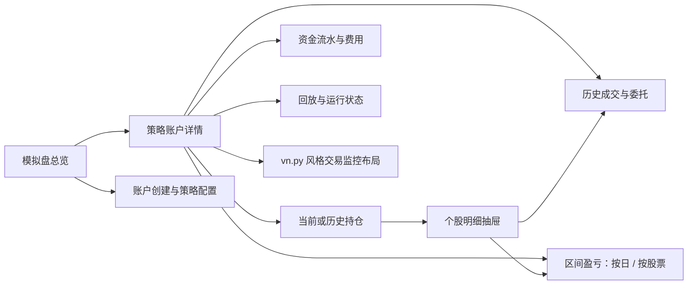
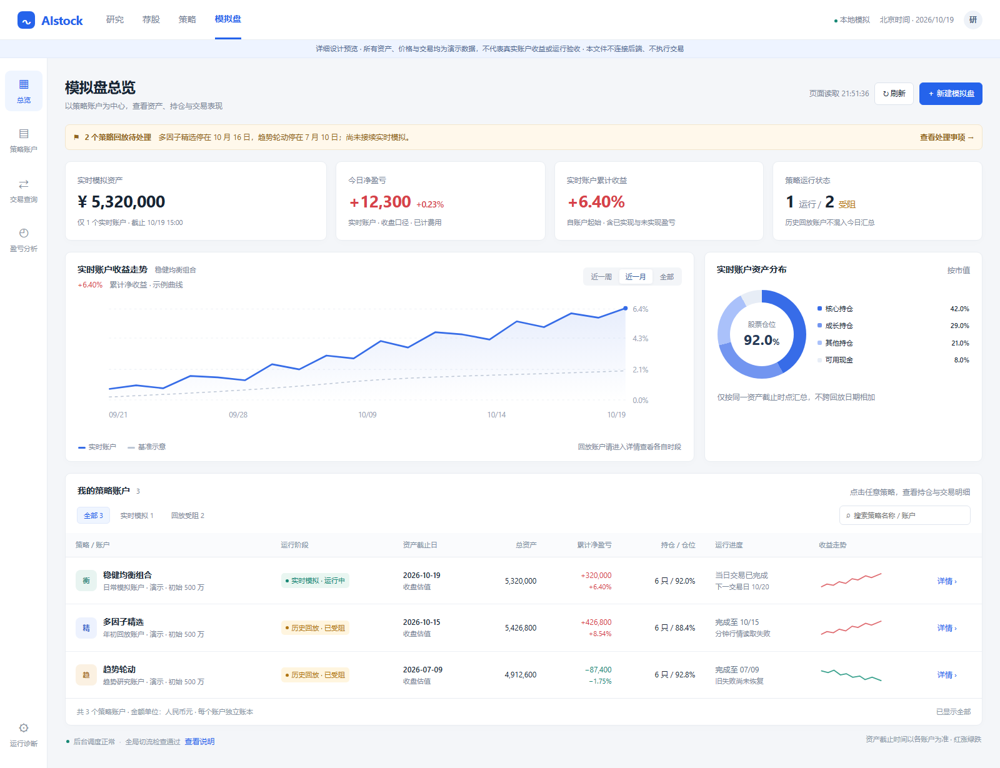
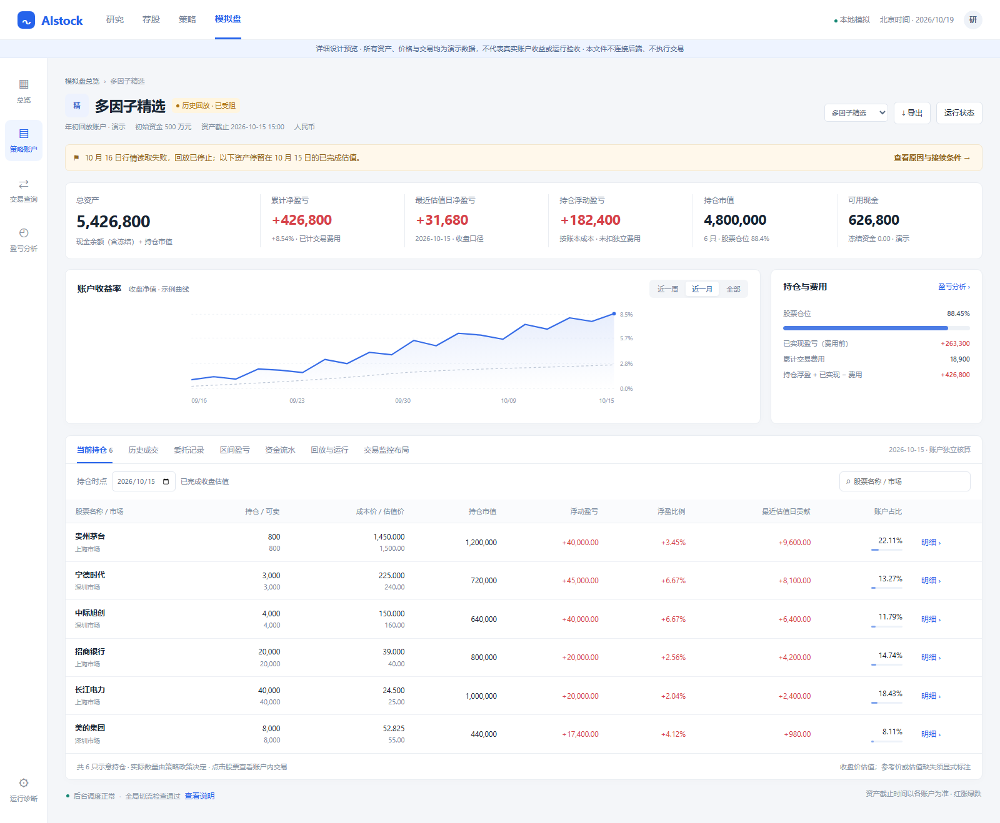
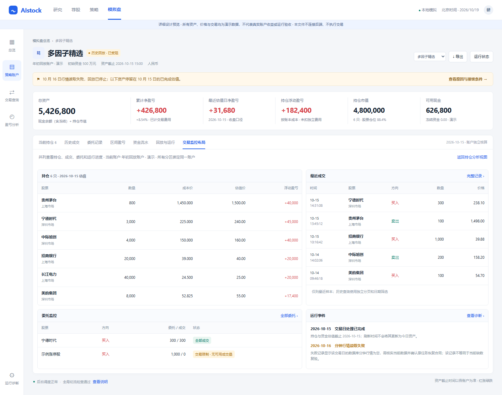
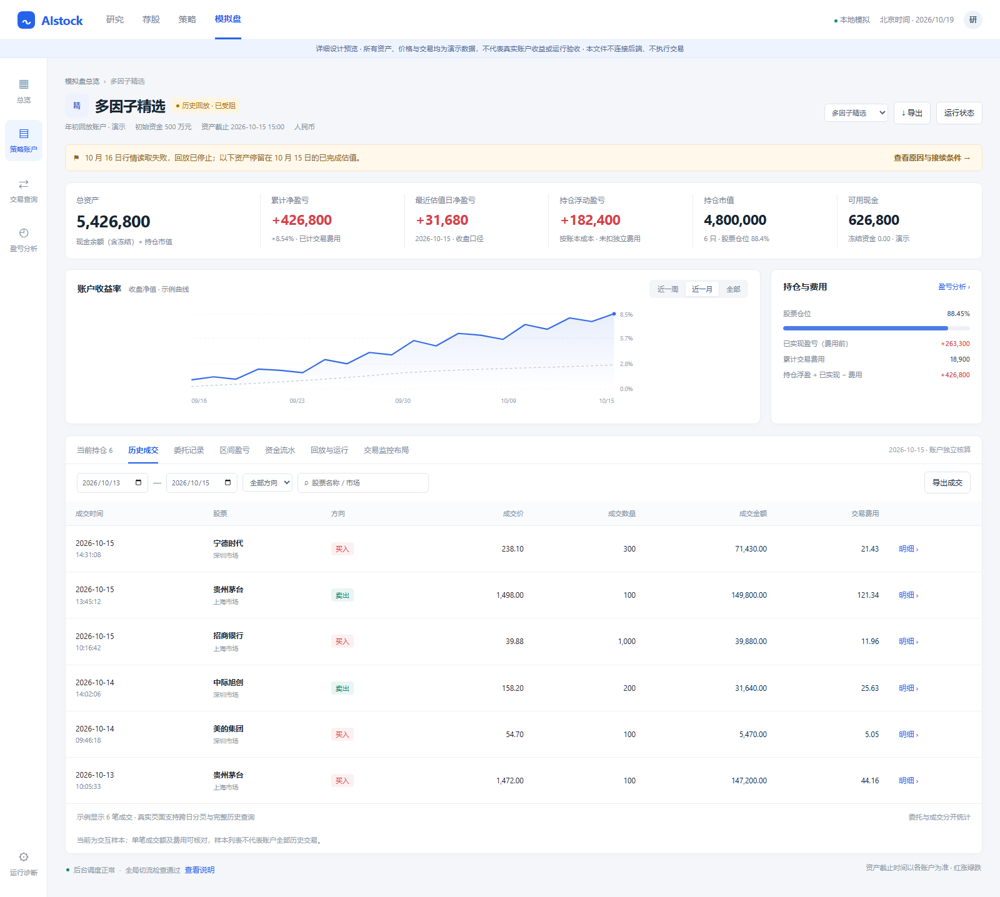
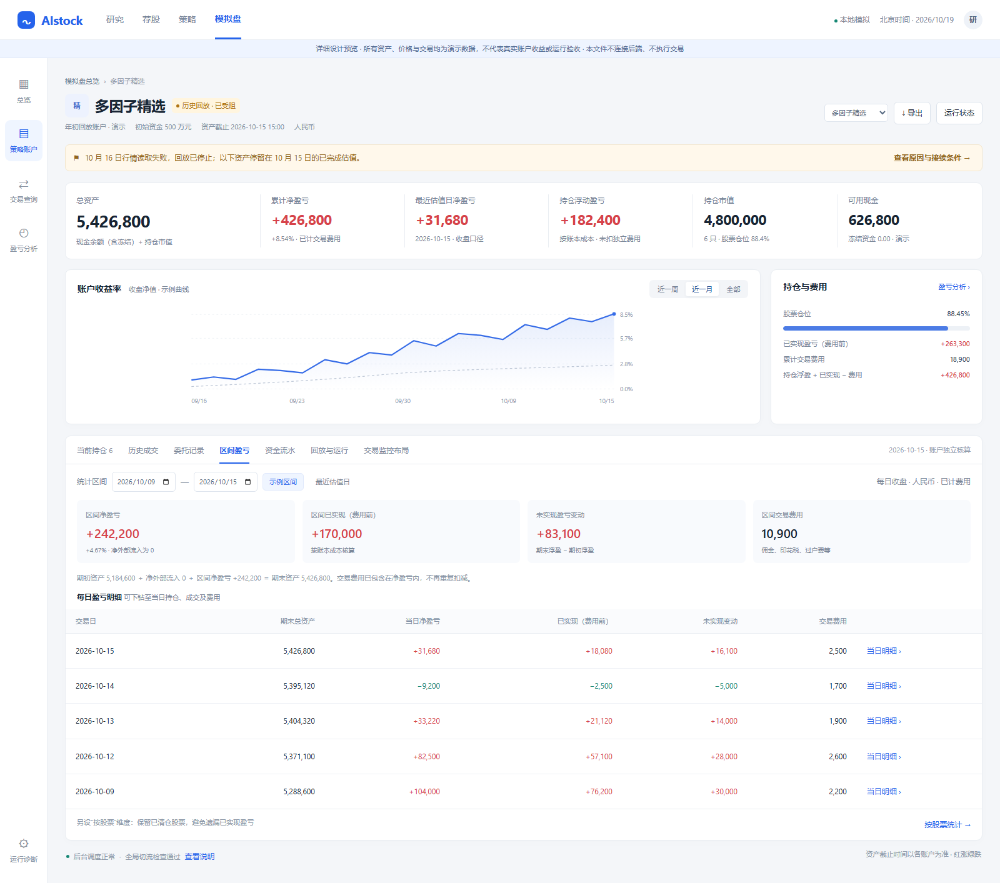

# LocalSIM 交易工作台概要设计

日期：2026-10-19。状态：概要布局已获继续详细设计授权；本轮按新增“全界面不显示机器标识或编码”要求修订。未实施应用代码、未接入真实数据、未合入或激活。

详细合同以 [交易工作台详细设计](../architecture/localsim_trading_workbench_detailed_design_20261019.md) 为准，包括只读接口、名称解析、财务边界、完整历史、交互与验收矩阵。

交付范围：总览、每个策略账户的持仓详情、个股下钻、历史委托与成交、区间盈亏、资金流水、业务化运行状态，以及 vn.py 风格的并列交易监控布局。所有截图和交互原型使用明确标注的演示数据，不能作为真实收益或生产回放验收。

## 1. 背景与设计方向

当前页面以创建配置、状态检查、技术身份和原始 JSON 为主；账户账本页面直接序列化返回对象，绩效页面仅展示快照字段，尚未形成交易软件的操作路径。用户需要先看到“策略赚亏多少、持有哪些股票、为什么变化”，再进入运行排查。

推荐采用“交易软件的资产与持仓视图 + vn.py 的交易监控分区”，在现有 Next.js / React 和 shadcn 兼容设计体系内实现。页面以策略账户为经济主体，以持仓、成交、现金和权威估值为事实依据。原始 JSON、策略包编号、哈希、运行编码、证券代码和内部路径均不在任何用户视图展示，包括折叠诊断、提示及导出。内部身份仍用于查询与隔离，不改变。

本设计按 **F1 单 LocalSIM 业务域功能**组织后续实施与验收索引；涉及的只读查询由 LocalSIM owner 完成，不引入第二套推理、撮合、资金或收益引擎。若实施发现需改变经济口径或跨模块权威合同，应先扩展设计并重新确认边界。

## 2. vn.py 参考可行性

已查阅截至本轮可访问的官方文档与源码，以下关于 vn.py 的功能限制是官方说明，不是对本仓库运行状态的推断。

| 参考对象 | 可采用的内容 | 在 LocalSIM 中的落地方式 | 工作量判断 |
| --- | --- | --- | --- |
| VnTrader 持仓、成交、委托、资金监控 | 紧凑表格、数值对齐、列排序、账户明确归属、并列监控分区 | 用现有 Web 组件重建；每个分区绑定同一策略账户和截止时点 | 界面层中等 |
| CTA 策略监控 | 策略列表、运行状态、参数与业务结果分层 | 账户列表支持按策略包归组，进入明确的账户实例；操作沿用既有后端授权与版本校验 | 界面中等，状态映射需核实 |
| Qt 界面源码 | 字段和交互组织可借鉴 | QtWidgets 控件不能作为 React 组件直接挂载；本轮不增加桌面应用或桌面嵌入 | 直接代码复用低 |
| PaperAccount 撮合和资金 | 可理解其模拟交易展示概念 | 官方文档说明其仿真不提供资金计算、委托与成交不持久保存；本设计继续使用 LocalSIM 的持久账本与经济结果 | 引擎替换高，且不属于本次方案 |
| 区间盈亏和个股历史分析 | 需在 LocalSIM 完成自己的查询合同 | 以已有账本、成交、估值快照为基础增加只读聚合和完整历史筛选 | 中等至较高，是主要后端工作 |

参考来源：

- [vn.py PaperAccount 官方说明](https://www.vnpy.com/docs/cn/community/app/paper_account.html)：本地模拟委托、成交和持仓监控；资金与持久化边界。
- [VnTrader 官方 UI 源码](https://github.com/vnpy/vnpy/blob/master/vnpy/trader/ui/widget.py)：BaseMonitor 基于 QtWidgets，包含持仓、资金、成交、委托的监控字段。
- [CTA 策略官方说明](https://www.vnpy.com/docs/cn/community/app/cta_strategy.html)：策略实例生命周期管理；策略逻辑持仓与账户实际持仓不能直接混为同一对象。
- [富途持仓设置](https://www.futuhk.com/hans/manual/topic11_106)及[资产分析](https://www.futuhk.com/cn/manual/topic11_85)：账户持仓字段、不同时间范围的资产走势和收益分析。
- [东方财富量化终端交易归档](https://emquant.18.cn/file-help/doc/file_order/statistics.html)：按账户和日期查看资金、持仓、成交与委托，日志作为独立信息。

结论：**参考 vn.py 的页面设计可行，无需为界面改版替换现有交易引擎。**主要投入在经济查询补齐、历史口径一致与前端交互，而非主题和颜色调整。此处是基于现有源码与官方资料的工程评估，不是工期承诺。

## 3. 信息架构与页面范围

| 页面 / 入口 | 首屏内容 | 主要交互 |
| --- | --- | --- |
| 总览 | 资产与净盈亏卡片、账户运行阶段、收益趋势、策略账户列表、待处理事项 | 搜索、按阶段筛选、点击策略进入账户；创建与配置收进独立入口 |
| 策略账户详情 | 账户身份、经济截止时间、总资产、净盈亏、浮盈、现金、市值、持仓表 | 快速切换账户、查询历史持仓、股票搜索与排序、列管理、导出 |
| 个股抽屉 | 本账户的股票数量、可卖、冻结、成本、估值、盈亏、相关成交 | 继承账户和股票筛选，进入完整交易或个股区间贡献 |
| 成交 / 委托 | 两类记录分别查询，不将委托量当作成交量 | 日期区间、股票、方向、状态筛选；跨日分页，导出完整筛选结果 |
| 区间盈亏 | 期初 / 期末资产、净流入、净盈亏、已实现、浮盈变动、费用 | 今天、近一周、近一月、年初至今、自定义；按日和按股票切换；逐日下钻 |
| 资金流水 | 买卖资金、佣金、税费、外部资金等账本条目 | 时间与类型筛选、关联成交、逐项对账 |
| 回放与运行 | 完成日期、下一处理日期、失败原因、接续状态、处理责任 | 全部采用业务语言；不提供原始错误或技术编号的展开入口 |
| 并列交易监控 | 同账户持仓、最近成交、委托和运行事件并列 | 适合持续盯盘；可进入完整分析页；不新增手工下单权限 |

同一策略包可存在多个账户或运行版本。总览可按包归组，但叶子节点必须是 `simulation_account_id`。点击包名有多个账户时展开选择，不能自动合并持仓与盈亏。账户详情、导出、缓存及分页始终包含账户身份；`package_id` 只是策略标签。

## 4. 总览设计

布局顺序：页面标题及刷新 → 待处理事项 → 四项核心指标 → 收益走势与资产分布 → 可点击的策略账户列表 → 简洁系统状态。

策略行包括：可读策略名、账户名、运行阶段、资产截止日、总资产、累计净盈亏及比例、持仓数量、仓位、最近完成交易日和下一事项。策略包 ID、哈希、运行标识不在任何页面或导出中显示；名称缺失使用业务提示，不回退为编号。同包多账户仍独立呈现。

默认总览的“今日”和实时汇总只包含可比、同一截止口径的实时模拟账户。历史回放账户在列表中独立展示其经济时钟；不能把七月、十月的估值加成一个“今日总资产”。后续若提供跨账户组合分析，须先对齐统一估值日、纳入账户范围和资金流口径，再显示汇总与覆盖率。

全局切流检查下沉至页底“系统状态”：通过只意味着相应全局安全条件满足。账户是否追平、是否在安全时点建立正式绑定，在每一策略行独立呈现，不以一个绿色框代替。

## 5. 策略详情和个股下钻

首屏默认持仓：证券简称 / 市场、数量 / 可卖、冻结数量、账本成本价、估值价及价格时点、市值、浮动盈亏、浮盈比例、当日或最近估值日盈亏贡献、账户占比。不显示证券编码。宽屏保留主要列，窄屏固定股票列并横向滚动；列选择和排序作为账户视图设置保存。原型为紧凑布局合并了部分字段，正式验收须覆盖冻结量与估值来源等完整字段。

所有持仓明细都来自明确账户与明确估值日的一组完整快照。历史持仓日切换必须重新查询，不把当前仓位投影到历史。点击股票后，抽屉展示同账户、同股票的交易与费用，可继续查询已清仓股票的历史。

账户启用状态与运行阶段分开显示。“启用”不推导成“正在交易”；停止、回放受阻的账户仍可以查看其最后完成的持仓与账本。

vn.py 风格的可选并列布局：

采用持仓、成交、委托、事件四个监控分区，顶部固定账户资金，保持当前策略上下文。日志不与经济数据争夺主视图。默认点击、双击均为查询下钻；不照搬桌面终端双击撤单等有写入副作用的交互。

## 6. 历史交易与区间盈亏

委托列：交易日、委托时间、股票、方向、委托数量、已成交数量、价格、状态、未完成原因。成交列：成交时间、股票、方向、成交价、成交量、金额、分项费用、可点击的关联委托。订单和成交内部身份不展示，详情按真实关联保留多次部分成交。统一时间显示为北京时间，过滤范围按正式交易日历解析。

区间支持“按日”和“按股票”。按股票统计必须包含期初持仓股、区间交易股和已清仓股，不能只统计当前仍持有的股票。用户可从每日盈亏进入当日持仓、成交与费用。账户及证券内部选择保留在私有页面历史和会话状态中，日期等可读条件可以进入 URL；刷新或返回恢复筛选，地址栏不暴露内部编号。

核心口径：

- 总资产 = 现金余额（含冻结）+ 权威估值市值；可用现金、冻结现金分别展示。应收应付、分红及公司行动等沿用现有账本口径，需要时单列，不由 UI 自行简化。
- 持仓浮盈 = 当前估值与既有成本口径之差；不能替换为累计净盈亏。成本是否含费用必须显式说明。
- 区间净盈亏 = 期末总资产 − 期初总资产 − 净外部资金流入。统计开始日的期初采用前一合法估值边界，结束日采用该范围内的合法期末边界；展示用户选择区间与实际估值区间。
- 已实现、未实现变动、分红或其他收益、费用等分项由权威查询解释至净盈亏。成本若已含费用，不再独立重复扣费。最小五元佣金及税费按实际账本纳入，并可查看小额交易的费用占比。
- 无外部资金流且覆盖完整时，区间收益率采用净盈亏 / 期初资产；存在流入流出时采用明确的服务端收益口径，显示所用方法。尚无权威算法时显示未提供，不以简单相除代替。
- “今日”仅指当前合法交易日；停止在历史的账户显示“最近估值日”。盘中估算与已完成收盘估值使用不同标识，不把 09:34 快照当成收盘收益。
- 任一必需价格、边界快照或账本片段缺失，金额显示“暂不可计算”及缺失原因；已知部分可展示并标注覆盖范围，绝不以 0、空数组或新鲜行情覆盖旧时点。
- 未绑定合法基准时不展示超额收益。示例曲线只用于布局，正式图表必须逐点对应所选期间的权威序列。

## 7. 回放和异常状态

运行阶段分为：等待开始、历史回放、推理进行中、回放受阻、追平既定区间、等待安全切换、实时模拟、暂停、退役。历史区间完成不自动等于追平最新交易日；新追平任务与原任务归属于同一账户，但保留独立任务身份和完成边界。

异常以“什么事 → 发生日 / 股票 → 对资产及进度的影响 → 处理责任 / 下一步”组织。程序 / 数据问题和停牌、涨跌停、无可用成交量等交易限制分开；无法完成全部调仓不直接判为程序失败。

刷新失败保留最后成功值并标记过期，不继续显示为实时。账户、经济估值、回放和调度各自显示截至日期或更新时间；不得以页面刷新时间冒充后台估值更新。控制操作完全沿用后端前置条件，界面不因摘要判断自行放开恢复或切流。

## 8. 现有接口与最小补齐范围

本轮阅读的源码：`backend/routers/simulation_runtime.py`、`backend/services/simulation_runtime/localsim_economic_query.py`、`frontend/src/lib/simulation/localsim/api.ts` 及现有 LocalSIM 账户 / 账本 / 绩效页面。

| 数据能力 | 已有基础 | 正式改版仍需补齐 |
| --- | --- | --- |
| 账户、策略、绑定、回放 | 现有控制面和列表接口 | 只读展示投影：当前经济时点、运行阶段与最后完成交易日；包与多账户明确关联 |
| 持仓、委托、成交、资金流水 | `accounts/{id}/ledger` 已返回对应记录 | 类型化字段、按估值日的完整持仓集合、分页、证券名称、成本及估值来源 |
| 跨日交易 | 已有订单与成交投影 | 服务端账户 / 日期 / 股票 / 方向筛选及游标；当前固定 LIMIT 和最近 run 子集不能代表全部历史 |
| 绩效 | `accounts/{id}/performance` 返回日快照 | 合法收盘边界选择、完整覆盖范围、区间资金流与费用、每日及个股贡献 |
| 运行记录 | 生命周期和经济结果联合投影 | 按身份关联展示，同一 run 的不同投影不能重复统计成交、资金或运行成功次数 |
| 行情身份 | 回放已有冻结源，实时行情有独立来源 | 展示数据来源与估值时间；只读账本从数据库查询，不代表历史回放行情改成数据库模式 |
| 更新机制 | 现有可见页面定时读回 | 分资源刷新、隐藏页停止、无副作用和完整错误态；订阅推送仅在实际负载需要时另行设计 |

新增能力优先放入 LocalSIM 经济查询服务与类型化只读路由；具体 URL 和 schema 在详细设计时确定。分页、缺失覆盖及区间边界是接口合同，不能在浏览器下载最近 100 / 200 行后推算“完整账户收益”。当前持仓投影可能混合多个日期，必须由服务端选择同一合法快照日并证明完整性。

新增这些查询不修改订单、持仓、资金或账本的写入语义，不复制共享选股、收益结算或撮合算法，不调用 Advisory 私有收益适配器。合法价格获取仍遵守冻结来源、覆盖和 PIT 政策；不以 UI 改版绕过文件终点、缺价或旧回放恢复合同。

## 9. 实施顺序与验证方案

1. **经济查询详细合同**：资产、成本、估值、费用与资金流定义；账户 / 交易日 / 股票身份、历史分页和未知值；为现有账户做独立只读勾稽。
2. **总览与策略详情**：先交付真实持仓、资金、完成日期和清楚的状态；所有界面移除原始 JSON 与机器标识，创建配置独立收纳并使用可读名称。
3. **交易与资金查询**：完整历史分页、筛选继承、个股下钻、导出与订单成交关联。
4. **区间盈亏与监控布局**：按日 / 股票统计，清仓与费用覆盖，统一估值边界；并列监控复用相同查询而非第二套数据缓存。
5. **多轮审核与回归**：源码和经济合同审查、桌面 / 窄屏 UI、跨账户隔离、缺价 / 不完整 / 过期状态、账本对账；真实接入通过前不报告正式完成。

建议的直接验收：指定账户持仓数量和市值合计对齐权威快照；现金余额与流水对齐；成交总量、金额和费用分项对齐；相同 run 经济投影去重；期初资产 + 净流入 + 净盈亏 = 期末资产；股票贡献合计对齐区间净盈亏并解释非股票差额；跨页历史查询不遗漏；回放暂停和实时账户不串日期或缓存。

## 10. Design Acceptance Index

以下为**概设覆盖**，不是应用实现或生产验收通过。

| design_item | implementation_refs | test_or_evidence | status | gap_or_exception |
| --- | --- | --- | --- | --- |
| LSUI-01 总览以策略账户为中心 | 原型总览；第 4 节 | artifact: localsim_trading_workbench_20261019/overview.png | design covered | 真实经济查询与页面未实施 |
| LSUI-02 任意策略账户持仓与资金 | 原型策略账户持仓；第 5 节 | artifact: localsim_trading_workbench_20261019/strategy-detail.png | design covered | 完整历史持仓集合、冻结字段待正式接口验收 |
| LSUI-03 个股下钻继承账户与股票 | 原型个股抽屉；第 5 节 | 浏览器点击股票并核对抽屉账户 | design covered | 原型展示抽屉样本，完整查询筛选在详细设计实施 |
| LSUI-04 历史成交、委托与费用 | 原型 `trades` / `orders`；第 6 节 | artifact: localsim_trading_workbench_20261019/historical-trades.png | design covered | 正式服务端分页与导出未实施 |
| LSUI-05 自定义区间和按日 / 股票盈亏 | 原型 `pnl`；第 6 节 | artifact: localsim_trading_workbench_20261019/period-pnl.png | design covered | 原型可计算示例区间；按股票表及清仓历史为明确实施项 |
| LSUI-06 资金流水、佣金与税费 | 原型 `cash`；第 6 节 | 原型显示成交资金与独立佣金条目 | design covered | 实际分项费用与资金流待合同核对 |
| LSUI-07 全界面没有原始 JSON | 全部业务页、弹窗、运行状态和导出 | 浏览器核对全部标签与可展开内容 | design covered | 应用源码未改；不存在技术 JSON 例外 |
| LSUI-08 回放 / 实时和截止日明确 | 总览、详情及运行标签；第 7 节 | 不同账户示例显示不同资产截止日 | design covered | 实际最新合法快照及接续状态待后端投影 |
| LSUI-09 vn.py 交易监控布局 | 原型 `monitor`；第 2、5 节 | artifact: localsim_trading_workbench_20261019/trading-monitor.png | design covered | 仅借鉴布局，无引擎或 Qt 依赖接入 |
| LSUI-10 未知值、过期及交易限制 | 第 6、7、8 节 | 原型委托展示涨停未成交；详细验收方案 | design covered | 真实错误态与覆盖合同须实施验证 |
| LSUI-11 不改变经济、推理与恢复合同 | 第 8、9、11 节 | 本轮仅新增设计与离线原型文件 | design covered | 应用实现阶段须再次逐项审查 |
| LSUI-12 全面禁止机器标识与编码 | 详细设计第 2、3、9 节；更新后的五张图 | 所有原型账户和标签的文本、提示、标题和可读路由检查 | design covered | 应用、真实导出和异常分支待实施 |
| LSUI-13 缺名与重名 | 详细设计第 2 节 | 已定义缺名、名称内含编号及重名合同 | design covered | 真实元数据接入与样本回归待实施 |
| LSUI-14 稳定读取和隔离 | 详细设计第 7、8 节 | 已定义一致集合、游标和请求取消 | design covered | 并发与真实分页待实施 |
| LSUI-15 完整导出与响应式 | 详细设计第 8、9 节 | 离线宽窄屏浏览检查；完整导出合同 | design covered | 真实导出待实施 |

## 11. 范围、风险与生产门禁

本轮仅交付概要设计及可交互 UI 原型。原型内按钮有完整样本交互和明确提示的设计入口；导出、历史持仓重新查询、按股票完整统计等不连接服务端的入口均不冒充真实功能。示例数量不是 TopK 约束，正式持仓数量按原策略政策和实际成交确定。

原型内价格、收益曲线、仓位和成交均为独立演示数据，名称为可读演示别名，不将演示金额当成真实账户结果，也不在界面显示真实策略包标识。当前问题的少量业务描述取自只读交接，仅用于说明异常位置，不构成再验收或恢复授权。

主要风险是历史快照不完整、日期混用、重复经济投影、费用重复扣减、只统计现存持仓导致漏掉已清仓收益、跨账户缓存，以及创建 / 切流与浏览操作混杂。按第 8、9 节合同和回归解决，不能仅靠前端美化消除。

生产状态：应用代码修改 **无**；数据库 DDL / DML **无**；生产服务启停 **无**；账户 / 断点 / 账本写入 **无**；回放或真实资金交易启动 **无**；合入与运行激活 **未执行**。早先登记的 BUG-1989 保持未修复，不以本设计交付关闭。

DESIGN-COMPLIANCE-001：概设和页面图已按用户新增要求同步；明确区分原型与真实实现；不隐藏经济查询缺口或伪造收益；不改变既有交易语义；不新增恢复、切流或生产操作授权。后续正式实施按详细设计维护此索引与真实证据矩阵。

## 12. 交付文件与查看方式

- [离线交互原型](localsim_trading_workbench_20261019/index.html)：浏览器直接打开；支持点击策略、切换标签、个股抽屉、样本成交筛选和样本日期区间统计。
- [总览图](localsim_trading_workbench_20261019/overview.png)、[策略详情图](localsim_trading_workbench_20261019/strategy-detail.png)、[并列监控图](localsim_trading_workbench_20261019/trading-monitor.png)。
- [历史成交图](localsim_trading_workbench_20261019/historical-trades.png)、[区间盈亏图](localsim_trading_workbench_20261019/period-pnl.png)。

设计分支：`docs/localsim-trading-ui-design-20261019`。本轮不以概设文件运行实现完成门禁，不申报真实功能 ready for PR / merge。
